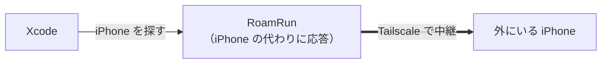
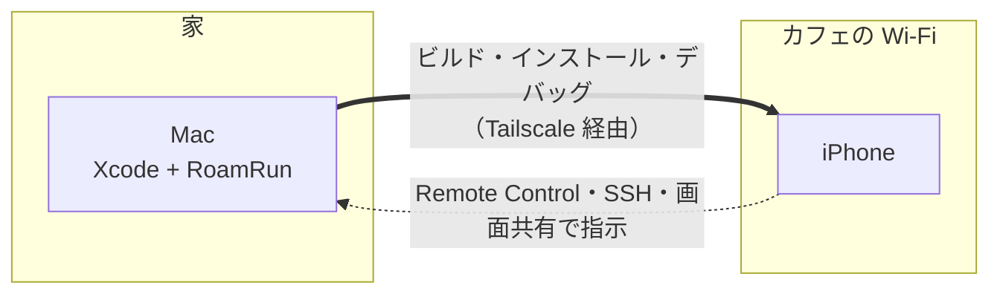
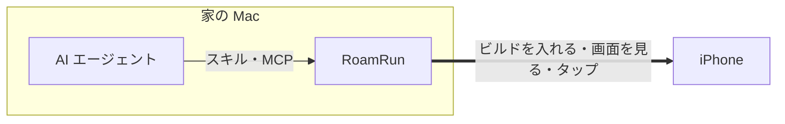
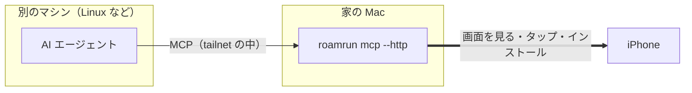
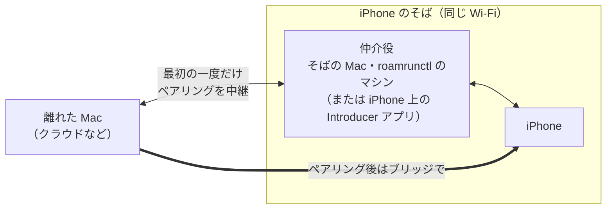
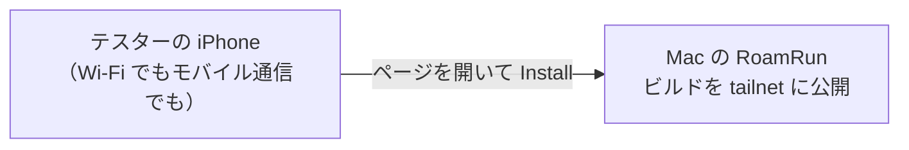
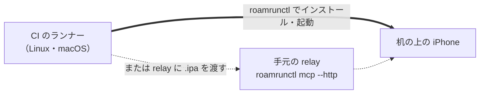
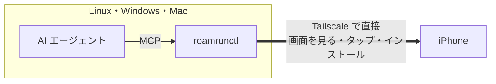

カフェで iPhone を触っていて、家の Mac にある Xcode からちょっと直したものを入れたい。けれど、Xcode のワイヤレスデバッグは、Mac と iPhone が同じ Wi-Fi にいないと使えません。

[RoamRun](https://github.com/mh-mobile/RoamRun) は、Tailscale を使ってこの制限をなくす macOS のメニューバーアプリです。Tailscale は、自分の機器どうしを安全につなぐ VPN です。iPhone がカフェの Wi-Fi にいても、家の Mac の Xcode からは、いつもの「手元のデバイス」として見えます。

この記事では、仕組みはごく短く済ませて、RoamRun で何ができるかを場面ごとに紹介します。


## しくみ

Xcode は、ワイヤレスでつなぐ iPhone を、同じネットワークの中で探します（Bonjour という仕組みです）。この探し方はネットワークの外に届かないので、外にいる iPhone は見つかりません。

RoamRun は、家のネットワークに「iPhone はここにいます」という案内を、iPhone の代わりに出します。案内の行き先は Mac 自身です。Xcode がそこへつなぐと、RoamRun がその通信を Tailscale 経由で本物の iPhone へ中継します。



ペアリングの確認と暗号化は、Apple の仕組みのまま Mac と iPhone の間で行われます。RoamRun は通信を運ぶだけで、中身は読みません。

## できること

| やりたいこと | 必要なもの |
|---|---|
| 外出先の iPhone に、家の Mac の Xcode からビルドしてデバッグする | iOS 17.4 以降 |
| AI エージェントに、ビルドから実機での確認まで任せる | iOS 17.4 以降（画面の操作は iOS 27 以降） |
| 別のマシンにいるエージェントから、家の Mac を通して iPhone を操作する | iOS 27 以降 |
| クラウドの Mac を、手元の iPhone とペアリングする | iOS 27 と Xcode 27 |
| テスターの iPhone に、Mac なしでビルドを入れてもらう | Ad Hoc か Enterprise で署名したビルド |
| CI のジョブから、実機にアプリを入れて起動する | iOS 27 以降 |
| Xcode のないマシンから、Mac を通さずに iPhone を使う | iOS 27 以降 |

どの使い方でも、iPhone と、それを使う側のマシン（Mac、Linux のマシン、CI のランナーなど）の両方に Tailscale を入れておきます。Tailscale でつないだ自分の機器のネットワークを、tailnet と呼びます。この記事でもその名前を使います。

## 1. カフェの iPhone に、家の Mac の Xcode からビルドする



いちばん基本の使い方です。RoamRun でデバイスを登録して、Start Bridge を押します（このつながりを RoamRun は「ブリッジ」と呼びます）。あとは、iPhone が家を出ても、Xcode の Devices ウインドウからデバイスが消えません。Run もブレークポイントも、いつもどおりに使えます。

iPhone が家の Wi-Fi にいる間、RoamRun は何もせずに待っています。iPhone が別のネットワークに移ると、RoamRun が自動でつなぎます。家と外の切り替えを意識する必要はありません。

ただし、ビルドするのは家の Mac です。外から Mac を動かす方法は、3 つあります。

- **AI エージェントに頼む。** Claude Code の Remote Control や、ChatGPT アプリの Codex を使うと、iPhone から家の Mac のエージェントを動かせます。「ビルドして iPhone で実行して」と頼み、結果を iPhone で見て、また頼む、の繰り返しです。
- **SSH で入る。** プロジェクトのフォルダで `roamrun run iPhone` と打つと、ビルド、インストール、起動まで進みます（`iPhone` は RoamRun で付けた名前）。
- **画面共有で Mac のデスクトップを表示する。** Xcode のウインドウをそのまま使えます。

外で使うときのコツです。

- iPhone は、ロックを解除して画面をつけておきます。スリープすると、iPhone の Tailscale も止まります。
- ブリッジを始めるには、iPhone をインターネットにつながる Wi-Fi へ接続しておきます。カフェやホテルの Wi-Fi、モバイルルーター、別のスマートフォンのテザリングが使えます。モバイル通信だけでは始められません。
- ブレークポイントが要らないときは、スキームの「Debug executable」をオフにします。外ではデバッガの接続に時間がかかります。600 KB のアプリをテザリング越しに実行したとき、デバッガを付けると約 1 分、付けないと約 4 秒でした。

## 2. AI エージェントに、実機での確認まで任せる



`roamrun init` を実行すると、Claude Code、Codex、Cursor などのエージェントにスキルが入ります。スキルは、エージェント向けの RoamRun の使い方の説明書です。これで、エージェントがブリッジを始めて、ビルドしてデバイスで動かせるようになります。

iOS 27 以降なら、エージェントがデバイスの画面を見て操作できます。RoamRun はこれを「デバイス操作」と呼んでいます。デバイスを Mac と同じ Wi-Fi に置いて一度だけ設定すれば、あとはデバイスがどこかの Wi-Fi にいる限り、Tailscale 越しに使えます。エージェントからは、外部のツールを呼ぶ仕組み（MCP）を通して使います。

```sh
claude mcp add roamrun -- roamrun mcp
```

エージェントにできるのは、次の操作です。

- 画面を見る、画面上の要素を読み取る
- タップやスワイプをする、文字を入力する、ホームなどのボタンを押す
- アプリを入れて起動する

たとえば、こんなふうに頼めます。

- 「ビルドして iPhone に入れて、ログイン画面までたどって、表示が崩れていないか見て」
- 「設定画面のトグルを全部オンにして、クラッシュしないか確かめて」

タップとスワイプは、直前 1 分以内に画面を見ていないと断られます。1 回見るごとに、1 回だけ押せます。古い画面を見たまま、思わぬ場所を押し続けないための決まりです。

1 つ注意があります。デバイス操作をオンにしている間は、その Mac で動くどのプログラムからでも、デバイスを見て操作できます。使っていないときは、デバイスのページのスイッチでオフにしておくのがおすすめです。

## 3. 別のマシンにいるエージェントから使う



Mac の `roamrun mcp` を tailnet の中へ公開すると、別のマシンにいるエージェントも、家の Mac を通して同じツールで iPhone を操作できます。

```sh
roamrun mcp --http 9090 --allow tag:agents --allow-install
```

`--allow` では、呼び出しを受け付けるマシンを決めます。Tailscale の管理画面でマシンに付けたタグ（例では `tag:agents`）か、マシンの持ち主のログイン名で指定します。`--allow-install` を付けると、相手のマシンが .ipa をアップロードしてインストールできます。公開している間は、許したマシンのどのプログラムからでも操作できます。

tailnet の Linux マシンからスクリプトで呼び出して、アップロード、インストール、起動まで動くことを確かめました。

## 4. クラウドの Mac を、手元の iPhone とペアリングする



ブリッジを使うには、Xcode でそのデバイスとペアリングした Mac が必要です。でも、データセンターの Mac やエージェント専用の Mac は、iPhone と同じ Wi-Fi に置けません。

iOS 27 と Xcode 27 なら、iPhone のそばにある Mac が一度だけ仲介して、離れた Mac をペアリングできます。

`cloud-mac` と `macbook-pro` は、それぞれの Mac の Tailscale 上の名前です。

離れた Mac（cloud-mac）では、Xcode の Device Hub › ＋ › Pair Nearby Device を開いておき、次を実行します。

```sh
roamrun pair xcode --with macbook-pro
```

iPhone のそばの Mac（macbook-pro）では、次を実行します。

```sh
roamrun pair introduce --host cloud-mac --to iPhone
```

iPhone の 設定 › プライバシーとセキュリティ › デベロッパモード で「cloud-mac」を選び、離れた Mac の Device Hub に出たコードを入れます。コードを読むには、離れた Mac の画面を画面共有で見ます。ペアリングが済めば、離れた Mac からもブリッジでデバイスを使えます。

iPhone のそばに Mac がなくても、ペアリングできます。

- **iPhone 自身に仲介させる。** RoamRun Introducer という iPhone アプリがあります（App Store にはなく、Xcode でビルドして入れます）。離れた Mac で `roamrun pair xcode --with <iPhone の Tailscale 上の名前> --qr` を実行します。表示された QR コードをアプリで読んで、Introduce を押します。

  

- **Windows や Linux のマシンに仲介させる。** `roamrunctl` というコマンドを使います（6 節で紹介します）。

## 5. テスターの iPhone に、Mac なしでビルドを入れてもらう



`roamrun ota` は、tailnet の中のページにビルドを公開します。iPhone でそのページを開いて Install をタップすると、iPhone が自分でビルドを入れます。

```sh
roamrun ota build/MyApp.ipa
```

ブリッジもペアリングも要らず、モバイル通信でも入れられます。次のような場面に向いています。

- この Mac とペアリングしたことのない、ほかの人の iPhone に入れたい
- テスターに配る Ad Hoc ビルドを、配る前に自分で試したい
- 同じ tailnet のチームメンバーに、Mac なしでインストールしてもらいたい

できるのはインストールだけで、デバッガは使えません。

## 6. CI のジョブから、実機にアプリを入れて起動する



`roamrunctl` は、RoamRun を入れていないマシン向けのコマンドです。Linux、Windows、macOS で動き、Xcode も要りません。これを使うと、署名済みの .ipa を、CI のジョブから Tailscale 越しに実機へ入れて起動できます。

| CI | 使うもの |
|---|---|
| GitHub Actions | [mh-mobile/roamrun-action](https://github.com/mh-mobile/roamrun-action)（Linux と macOS のランナー） |
| Xcode Cloud | プロジェクトのスクリプトから Tailscale を起動 |
| Bitrise | Step の [mh-mobile/bitrise-step-roamrun](https://github.com/mh-mobile/bitrise-step-roamrun) |

Linux のランナーでも、机の上の iPhone にビルドを入れて起動するところまでできます。

デバイスとのペアリングの置き場所は、2 通りから選べます。1 つは、CI のシークレットに置いて、ランナーから直接入れるやり方です。もう 1 つは、ペアリングを持つ手元のマシン（図の relay）に .ipa を渡して、入れてもらうやり方です。relay では `roamrunctl mcp --http` を動かしておきます。

## 7. Xcode のないマシンから iPhone を使う



`roamrunctl` は、CI 以外でも使えます。3 節は家の Mac を通しますが、こちらは Mac を通さず、そのマシンが直接 iPhone とつながります。まず、そのマシンで `roamrunctl pair control` を使ってデバイスとペアリングします（同じ Wi-Fi で直接か、Introducer アプリの仲介で）。そのあとは、スクリーンショットを撮ったり、アプリを入れて起動したりできます。MCP のサーバーとして動かせば、そのマシンのエージェントがタップや文字入力もできます。

## 使う前に知っておくこと

- RoamRun は、Apple が公開していない仕組みの上で動いています。iOS、macOS、Xcode の更新で動かなくなる可能性があります。
- 試した範囲は次のとおりです。ブリッジは iPhone、iPad、Apple Vision Pro で、デバイス操作と `roamrunctl` は iPhone だけで動かしています。`roamrunctl` は Linux と macOS で、画面の操作、インストール、起動まで試しました（Linux で MCP を通したインストールは未確認）。Windows では、MCP、インストール、起動をまだ試していません。CI は 3 つとも、iOS 27.0 の iPhone 15 Pro へのインストールと起動まで試しました。Flutter と React Native では試していません。
- デバイス操作、`roamrun mcp`、OTA のページは、RoamRun のアプリが起動している間だけ使えます。
- 一度もペアリングしたことのない iPhone は、4 節の仲介を始められません。先にどれか 1 台の Mac で一度ペアリングしておきます。
- 離れた Mac でブレークポイントを使うには、デバイスの OS のシンボル（約 6 GB）が離れた Mac に要ります。
- `roamrunctl` 自体はビルドも署名もしません。CI のシークレットを読める人は、デバイスを操作できます。
- OTA には、tailnet の MagicDNS と HTTPS 証明書を有効にしておく必要があります。tailnet のメンバーなら、だれでもページを開いてインストールできます。
- Safari の Web インスペクタは、ブリッジ越しだと接続がたびたび切れます。

## はじめかた

Homebrew で入れられます。

```sh
brew install --cask mh-mobile/tap/roamrun
```

Apple シリコンの Mac と macOS 13 以降、管理者アカウントが必要です。iPhone は、その Mac と一度ペアリングして、デベロッパモードをオンにしておきます。iPhone を USB か同じ Wi-Fi でつなぎ、メニューバーのアイコンから Open RoamRun › Add Device を選べば、あとは画面の案内どおりに進めます。

詳しい使い方は [README](https://github.com/mh-mobile/RoamRun/blob/main/README.ja.md) に、`roamrunctl` の使い方は [roamrunctl の README](https://github.com/mh-mobile/RoamRun/blob/main/Rust/roamrunctl/README.ja.md) にあります。

家の Mac と手元の iPhone が別の場所にあっても、Xcode の使い方は変わりません。まずは 1 台、ブリッジを始めてみてください。動かないときは `roamrun doctor` の結果を添えて、[issue](https://github.com/mh-mobile/RoamRun/issues) で教えてもらえると助かります。
