カフェで iPhone を触っていて、家の Mac にある Xcode からちょっと直したものを入れたい。けれど、Xcode のワイヤレスデバッグは、Mac と同じネットワークの中にいる iPhone しか見つけられません。

[RoamRun](https://github.com/mh-mobile/RoamRun) は、Tailscale を使ってこの制限をなくす macOS のメニューバーアプリです。Tailscale は自分の機器どうしを安全につなぐ VPN です。iPhone がカフェの Wi-Fi にいても、家の Mac の Xcode からはいつもの「手元のデバイス」として見え、アプリのインストールやデバッグができます。

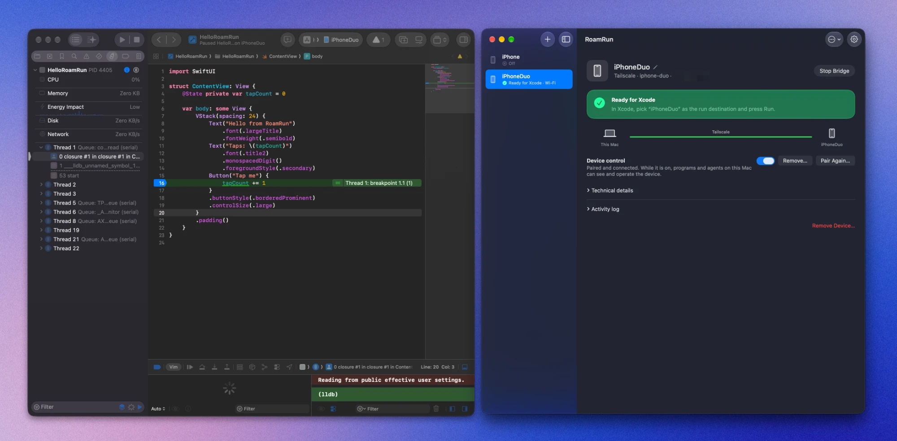

最初は Xcode から使うこの機能だけでしたが、そのあと、できることが増えました。

- AI エージェントが iPhone の画面を見て、タップや文字入力をする
- Linux や Windows から、Xcode なしで iPhone を使う
- クラウドの Mac や手元の仮想マシンから、手元の iPhone をデバッグする
- テスターが Mac なしでアプリを入れる（OTA）
- GitHub Actions、Xcode Cloud、Bitrise から実機にアプリを入れる

この記事では、基本の使い方から、実際に試したクラウドや AI エージェントとの組み合わせまで、場面ごとに紹介します。

## できること

### 3 つの機能

RoamRun の機能は、大きく 3 つです。Xcode の通信を外の iPhone まで運ぶ中継を「ブリッジ」、画面を見て操作する機能を「デバイス操作」と呼び、この 2 つは使うペアリングが違います。

| 機能 | できること | 使うペアリング | 必要なもの |
|---|---|---|---|
| ブリッジ | 外にいる iPhone に、Xcode からビルド、実行、デバッグをする | Xcode のペアリング | iOS 17.4 以降 |
| デバイス操作 | 画面を見る、タップや入力をする、アプリを入れて起動する（Xcode なしで） | デバイス操作のペアリング | iOS 27 以降 |
| OTA | テスターが iPhone でページを開いて、アプリを入れる | なし | Ad Hoc か Enterprise 用のビルド |

Xcode のペアリングは、Xcode で一度だけ作ります（USB か、iOS 27 と Xcode 27 なら同じ Wi-Fi）。離れた Mac とのペアリングは、iPhone のそばのマシンに仲介させて作れます（2 節）。デバイス操作のペアリングは RoamRun 独自のもので、作り方は 3 節で紹介します。デバイス操作は、Mac の RoamRun のほか、Linux や Windows でも動く `roamrunctl`（5 節）からも使えます。

この 2 種類のペアリングは、どちらも iPhone のデベロッパモードの一覧に出て、そこで取り消せます（[取り消し方](#%E5%8F%96%E3%82%8A%E6%B6%88%E3%81%97%E6%96%B9)）。

### 場面ごとの使い方

| 節 | やりたいこと | 主な条件 |
|---|---|---|
| [1](#1.-%E5%AE%B6%E3%81%AE-mac-%E3%81%AE-xcode-%E3%81%8B%E3%82%89%E3%82%AB%E3%83%95%E3%82%A7%E3%81%AE-iphone-%E3%81%AB%E3%83%93%E3%83%AB%E3%83%89%E3%81%99%E3%82%8B) | 家の Mac の Xcode から外出先の iPhone にビルドしてデバッグする | iOS 17.4 以降 |
| [2](#2.-%E9%9B%A2%E3%82%8C%E3%81%9F-mac%EF%BC%88%E3%82%AF%E3%83%A9%E3%82%A6%E3%83%89%E3%81%AA%E3%81%A9%EF%BC%89%E3%82%92%E6%89%8B%E5%85%83%E3%81%AE-iphone-%E3%81%A8%E3%83%9A%E3%82%A2%E3%83%AA%E3%83%B3%E3%82%B0%E3%81%99%E3%82%8B) | 離れた Mac（クラウドなど）を手元の iPhone とペアリングする | iOS 27 と Xcode 27 |
| [3](#3.-%E5%AE%9F%E6%A9%9F%E3%81%A7%E3%81%AE%E7%A2%BA%E8%AA%8D%E3%81%BE%E3%81%A7-ai-%E3%82%A8%E3%83%BC%E3%82%B8%E3%82%A7%E3%83%B3%E3%83%88%E3%81%AB%E4%BB%BB%E3%81%9B%E3%82%8B) | ビルドから実機での確認まで AI エージェントに任せる | iOS 17.4 以降（画面の操作は iOS 27 以降） |
| [4](#4.-%E5%88%A5%E3%81%AE%E3%83%9E%E3%82%B7%E3%83%B3%E3%81%AB%E3%81%84%E3%82%8B%E3%82%A8%E3%83%BC%E3%82%B8%E3%82%A7%E3%83%B3%E3%83%88%E3%81%8B%E3%82%89%E4%BD%BF%E3%81%86) | 別のマシンにいるエージェントが家の Mac を通して iPhone を操作する | iOS 27 以降 |
| [5](#5.-xcode-%E3%81%AE%E3%81%AA%E3%81%84%E3%83%9E%E3%82%B7%E3%83%B3%E3%81%8B%E3%82%89-iphone-%E3%82%92%E4%BD%BF%E3%81%86) | Xcode のないマシンで Mac を通さずに iPhone を使う | iOS 27 以降 |
| [6](#6.-%E3%82%AF%E3%83%A9%E3%82%A6%E3%83%89%E3%81%AE%E3%82%A8%E3%83%BC%E3%82%B8%E3%82%A7%E3%83%B3%E3%83%88%E3%81%8B%E3%82%89%E4%BD%BF%E3%81%86) | クラウドのエージェント（Codex Cloud、Grok Bot、Devin Cloud）から手元の iPhone を使う | iOS 27 以降（Devin Cloud は Xcode 27 も） |
| [7](#7.-%E6%89%8B%E5%85%83%E3%81%AE%E4%BB%AE%E6%83%B3%E3%83%9E%E3%82%B7%E3%83%B3%E3%81%AE%E3%82%A8%E3%83%BC%E3%82%B8%E3%82%A7%E3%83%B3%E3%83%88%E3%81%8B%E3%82%89%E4%BD%BF%E3%81%86%EF%BC%88tart-%E3%81%AE%E4%BE%8B%EF%BC%89) | 手元の仮想マシン（Tart）に閉じ込めたエージェントから iPhone を使う | iOS 27 と Xcode 27 |
| [8](#8.-%E3%82%B9%E3%83%9E%E3%83%BC%E3%83%88%E3%82%B0%E3%83%A9%E3%82%B9%E3%81%AE%E9%9F%B3%E5%A3%B0%E5%85%A5%E5%8A%9B%E3%81%A7%E9%A0%BC%E3%82%80%EF%BC%88even-g2-%E3%81%AE%E4%BE%8B%EF%BC%89) | スマートグラス（Even G2）の音声入力で頼んで、出先の iPhone のアプリを直して動かす | iOS 27 以降（この例は Xcode 27 も） |
| [9](#9.-%E3%83%86%E3%82%B9%E3%82%BF%E3%83%BC%E3%81%8C-mac-%E3%81%AA%E3%81%97%E3%81%A7%E3%82%A2%E3%83%97%E3%83%AA%E3%82%92%E5%85%A5%E3%82%8C%E3%82%8B) | テスターが Mac なしでアプリを入れる | Ad Hoc か Enterprise で署名したビルド |
| [10](#10.-ci-%E3%81%AE%E3%82%B8%E3%83%A7%E3%83%96%E3%81%8B%E3%82%89%E5%AE%9F%E6%A9%9F%E3%81%AB%E3%82%A2%E3%83%97%E3%83%AA%E3%82%92%E5%85%A5%E3%82%8C%E3%81%A6%E8%B5%B7%E5%8B%95%E3%81%99%E3%82%8B) | CI のジョブから実機にアプリを入れて起動する | iOS 27 以降 |

1・2 節は Xcode から使う方法、3〜8 節は AI エージェントや Xcode のないマシンから使う方法、9・10 節は人に配ったり CI から入れたりする方法です。10 節のあとには、1・2 節を組み合わせた想定例を 1 つ置きました。

どの使い方でも、iPhone とそれを使う側のマシン（Mac、Linux のマシン、CI のランナーなど）の両方に Tailscale を入れておきます。Tailscale でつないだ自分の機器のネットワークを tailnet と呼びます。この記事でもその名前を使います。

## 仕組み

Xcode はワイヤレスでつなぐ iPhone を同じネットワークの中で探します（Bonjour という仕組みです）。この探し方はネットワークの外に届かないので、外にいる iPhone は見つかりません。

RoamRun は、家のネットワークに「iPhone はここにいます」という案内を iPhone の代わりに出します。案内が指す接続先は Mac 自身です。Mac の中の Apple の仕組みがその案内を見て RoamRun の中継につなぐと、RoamRun がその通信を Tailscale 経由で本物の iPhone へ中継します。

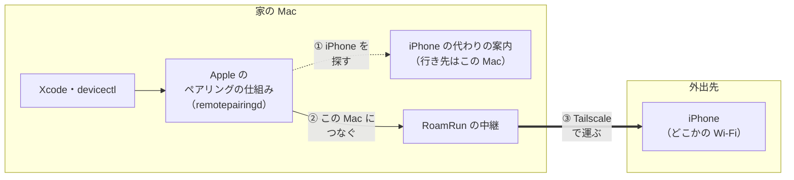

ペアリングの確認と暗号化は、Apple の実装のまま Mac と iPhone の間で行われます。ブリッジでは、RoamRun は通信を運ぶだけで、中身は読みません。もう少し詳しい流れは、RoamRun の [docs/how-it-works.ja.md](https://github.com/mh-mobile/RoamRun/blob/main/docs/how-it-works.ja.md) にあります。

## 1. 家の Mac の Xcode からカフェの iPhone にビルドする

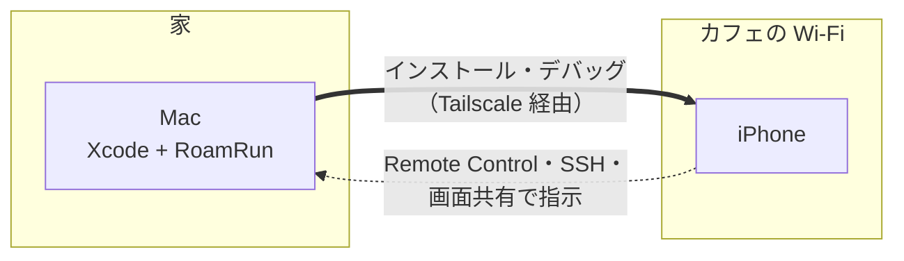

いちばん基本の使い方です。RoamRun で iPhone を登録して（手順はこの節の最後の「はじめかた」）、Start Bridge を押します。「Ready for Xcode」と出れば、iPhone が家の外でも Mac と Tailscale 越しにつながっています。iPhone が家を出ても、Xcode の Devices ウインドウから iPhone が消えません。Run もブレークポイントもいつもどおりに使えます。

iPhone が家の Wi-Fi にいる間、RoamRun は何もせずに待っています。iPhone が別のネットワークに移ると、RoamRun が自動でつなぎます。Wi-Fi どうしの移動なら、家と外の切り替えを意識する必要はありません（モバイル通信のときは、下の折り畳みを見てください）。

ただし、ビルドするのは家の Mac です。外から Mac を動かす方法は 3 つあります。

- **AI エージェントに頼む。** Claude Code の Remote Control や ChatGPT アプリの Codex を使うと、iPhone から家の Mac のエージェントを動かせます。「ビルドして iPhone で実行して」と頼んで、結果を iPhone で確かめ、直してほしいところをまた頼みます。
- **SSH で入る。** プロジェクトのフォルダで `roamrun run iPhone` と打つと、ビルド、インストール、起動まで進みます（`iPhone` は RoamRun で付けた名前）。
- **画面共有で Mac のデスクトップを表示する。** Xcode のウインドウをそのまま使えます。

外で使うときのコツです。

- iPhone はロックを解除して画面をつけておきます。スリープすると、iPhone の Tailscale も止まります。
- ブリッジを始めるには、iPhone をインターネットにつながる Wi-Fi へ接続しておきます。カフェやホテルの Wi-Fi、モバイルルーター、別のスマートフォンのテザリングが使えます。モバイル通信だけでは始められません。サインインの画面が出る Wi-Fi では、先にサインインしておきます。
- ブレークポイントが要らないときは、スキームの「Debug executable」をオフにします。外ではデバッガの接続に時間がかかります。600 KB のアプリをテザリング越しに実行したとき、デバッガを付けると約 1 分、付けないと約 4 秒でした。
- ブレークポイントが要るときは、スキームの「Queue Debugging」と「Main Thread Checker」をオフにすると速くなりました。
- UDP を通さないネットワークでは、Tailscale が中継サーバーを使うので遅くなります。経路は `roamrun doctor` で確かめられます。

:::details モバイル通信に移っても続けるには
RoamRun の Settings › Network › Keep debugging on cellular をオンにしておくと、ブリッジが Ready になったあとは、iPhone がモバイル通信へ移ってもセッションが続きます。初期設定はオフです。オンにすると、Run のたびに iPhone のモバイルデータ通信を使います。

家で「On this Wi‑Fi」と表示されているときは、Xcode が家の Wi-Fi で iPhone に直接つながっています。そのまま家を出てモバイル通信に移ると、セッションは切れます。家でも、別の機器が作る Wi-Fi（トラベルルーターやテザリング中の予備のスマートフォン）に iPhone をつないでおくと、最初からブリッジになります。
:::

### はじめかた

Homebrew で入れます。[Releases](https://github.com/mh-mobile/RoamRun/releases) の dmg からも入れられます。

```sh
brew install --cask mh-mobile/tap/roamrun
```

Apple シリコンの Mac、macOS 13 以降、管理者アカウントが必要です。Mac と iPhone の両方に Tailscale を入れて、同じ tailnet につないでおきます。iPhone はその Mac と一度ペアリングして、デベロッパモードをオンにしておきます。

1. iPhone を USB か同じ Wi-Fi でつなぎ、メニューバーのアイコンから Open RoamRun › Add Device を選びます。
2. 一覧から iPhone を選び、Tailscale 上の同じ iPhone と対応づけます。最後に名前を付けます。コマンドではこの名前を使います。

   

3. Start Bridge を押して、「Ready for Xcode」か「On this Wi‑Fi」になるまで待ちます。

   

4. Xcode の Devices ウインドウに iPhone が出ていれば、準備はできています。

うまくいかないときは、`roamrun doctor` を実行します。Mac、Tailscale、iPhone の順に確かめて、直し方を表示します。

詳しい使い方は [README](https://github.com/mh-mobile/RoamRun/blob/main/README.ja.md) にあります。

## 2. 離れた Mac（クラウドなど）を手元の iPhone とペアリングする

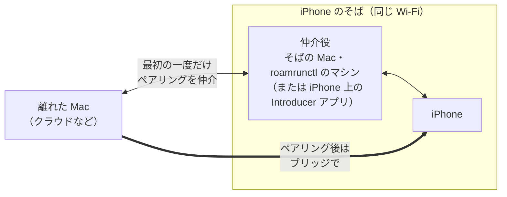

ブリッジを使うには、Xcode で iPhone とペアリングした Mac が必要です。でも、データセンターの Mac やエージェント専用の Mac は、iPhone と同じ Wi-Fi に置けません。

iOS 27 と Xcode 27 なら、iPhone のそばにある Mac が一度だけ仲介して、離れた Mac をペアリングできます。ただし、仲介できるのは、どれかの Mac と一度でもペアリングしたことのある iPhone です。

以下では、離れた Mac を `cloud-mac`、iPhone のそばの Mac を `macbook-pro` と呼びます。どちらも Tailscale 上の名前です。

1. 離れた Mac（cloud-mac）で、Xcode の Device Hub › ＋ › Pair Nearby Device を開いておき、次を実行します。

   ```sh
   roamrun pair xcode --with macbook-pro
   ```

   

2. iPhone のそばの Mac（macbook-pro）では、その Mac の RoamRun に iPhone を登録したうえで、次を実行します。`--to` には、RoamRun で登録したときに付けた名前（ここでは `iPhoneDuo`）を渡します。

   ```sh
   roamrun pair introduce --host cloud-mac --to iPhoneDuo
   ```

3. iPhone の 設定 › プライバシーとセキュリティ › デベロッパモード で離れた Mac を選びます（一覧には、その Mac のコンピュータ名で出ます）。

   

4. 離れた Mac の Device Hub に出たコードを、iPhone に入れます。コードは、離れた Mac の画面を画面共有で見て読みます。

ペアリングを試みた時点で、離れた Mac の RoamRun にも iPhone が保存されます（離れた Mac のコマンドがその名前を表示します）。あとは離れた Mac で `roamrun up iPhoneDuo`（ブリッジを始めるコマンド）を実行すれば、ブリッジで使えます。

一度でもペアリングしたことのある iPhone なら、そばに Mac がなくてもペアリングできます。

- **iPhone 自身に仲介させる。** RoamRun Introducer という iPhone アプリがあります（App Store にはなく、Xcode でビルドして入れます）。離れた Mac で `roamrun pair xcode --with <iPhone の Tailscale 上の名前> --qr` を実行します。表示された QR コードをアプリで読んで、Introduce を押します（QR コードの代わりに、離れた Mac の Tailscale 上の名前を入力してもかまいません）。あとは上と同じく、デベロッパモードで離れた Mac を選んでコードを入れます。

  

- **Windows や Linux のマシンに仲介させる。** `roamrunctl`（5 節）の `pair introduce` を使います。コマンドは、10 節のあとの想定例の折り畳みにあります。

:::details Apple Vision Pro の場合
Vision Pro では、デバイスの側が待ちます。設定 › 一般 › Remote Devices を開いたままにして、同じ 2 つのコマンドを使います。離れた Mac では、コマンドの案内に従って Device Hub › ＋ › Pair Nearby Device › Apple Vision Pro を開きます。デバイスを選んで Next を押し、Vision Pro に出たコードを離れた Mac に入れます。

仲介できるのは Mac だけで、Introducer アプリと `roamrunctl` は Vision Pro の仲介に対応していません。仮想マシンの離れた Mac でペアリングからブリッジの Ready まで試しました。
:::

## 3. 実機での確認まで AI エージェントに任せる

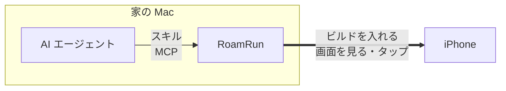

使うまでの流れは次のとおりです。

1. **デバイス操作のペアリングを作る。** 画面を見て操作させるときだけ要ります（iOS 27 以降）。iPhone を Mac と同じ Wi-Fi につなぎ、RoamRun のデバイスのページで Device control › Set Up… を押します。iPhone の 設定 › プライバシーとセキュリティ › デベロッパモード で「RoamRun (その Mac の名前)」を選び、Mac に出たコードを入れます。一度作れば、あとは iPhone がどこかの Wi-Fi にいる限り、Tailscale 越しに使えます。ブリッジでビルドして動かすだけなら、この手順は要りません。
2. **スキルを入れる。** `roamrun init` を実行すると、Claude Code、Codex、Cursor などのエージェントにスキルが入ります。スキルは、エージェントに RoamRun の使い方を教える説明書です。これで、エージェントがブリッジを始めて、ビルドして iPhone で動かせるようになります。
3. **MCP に登録する。** エージェントは、外部のツールを呼ぶ仕組み（MCP）を通して iPhone を操作できます（スキルがあれば、`roamrun` のコマンドでも同じ操作ができます）。Claude Code なら、次のように登録します。

   ```sh
   claude mcp add roamrun -- roamrun mcp
   ```

4. **頼む。** あとは、エージェントに話しかけるだけです。

MCP を通して頼める画面の操作は次のとおりです。

- 画面を見る、画面上の要素を読み取る
- タップやスワイプをする、文字を入力する、ホームなどのボタンを押す
- アプリを入れて起動する

たとえば、こんなふうに頼めます。

- 「ビルドして iPhone に入れて、ログイン画面までたどって、表示が崩れていないか見て」
- 「設定画面のトグルを全部オンにして、クラッシュしないか確かめて」

自分のアプリだけでなく、iPhone のほかのアプリも、画面を見てタップする形で操作できます。パソコンを操作させる「Computer Use」の iPhone 版のような使い方です。8 節の Even G2 の例でも、エージェントはホーム画面から Spotlight を開いてアプリの名前を入れ、アプリを起動しました。

:::message
ただし、人が指で操作するようにはいきません。

- どこを押すかは、エージェントが画面の画像を読んで決めます。読み違えて違う場所を押すことがあり、どれだけ正確かは使うモデルしだいです。RoamRun の MCP はエージェントに、頼まれていない購入、投稿、送信、削除、サインインは押さないよう伝えていますが、取り消せない操作は人が確かめてください。
- タップの前に毎回画面を見るので、画面を見てタップする 1 組に 1 秒弱かかります（8 節）。
- すぐに消える表示（短いアニメーションなど）は、次に画面を見たときには写っていないことがあります（8 節）。
- iPhone はこれを画面共有として扱います。見ている間は、音が止まるアプリや、見た画像が黒くなる動画アプリ、再生を止める動画アプリがあります。通話中は見られず（6 節の Grok Bot）、見ている間の音声入力は音を拾わないことがあります。
- 文字の入力は、iPhone のキーボードが英語のときだけ正しく入ります。日本語などはペーストで入れます（下の折り畳み）。
:::

:::details 画面共有を避けたいとき
スクリーンショット（PNG）で見る手があります。`roamrunctl`（5 節）は、Linux と Windows ではもともと PNG で見ます。このとき画面共有は出ず、試した範囲では音楽も止まりませんでした。macOS でも `ROAMRUNCTL_LOOK=screenshot` で PNG に切り替えられます。ただし、PNG は 1 回見るのに 10 秒以上かかることがあります。

Mac の RoamRun の `look` は、0.11.0 では画面共有だけで、スクリーンショットには切り替えられません。ブリッジが Ready なら、Xcode と同じ仕組みで撮る `roamrun screenshot` もありますが、撮った画像を見るためのもので、`tap` の位置指定には使えません。
:::

タップとスワイプは、直前 1 分以内に画面を見ていないと断られます。1 回見るごとに、タップかスワイプを 1 回だけできます。古い画面を見たまま思わぬ場所を押し続けないための決まりです。文字入力は、タップのあとも画面を見直さずに続けられます。

:::message
デバイス操作をオンにしている間は、その Mac で動くどのプログラムからでも iPhone を見て操作できます。使っていないときは、RoamRun でそのデバイスのページを開き、スイッチでオフにしておくのがおすすめです。
:::

:::details エージェントが画面を見てタップする流れ
エージェントは、次の順で呼びます。

1. `look` で画面を見る。画像とその look の番号が返ります。
2. 押したい位置（画像のピクセル）とその番号を `tap` に渡す。
3. もう一度 `look` して、画面が変わったかを見る。

文字は `type` で送れます。US 配列のキーとして送るので、正しく入るのは iPhone のキーボードが英語のときだけです。日本語キーボードではスペースも変換に使われて入りませんでした。日本語の文字や、US 配列にない文字は `paste` で入れます。こちらはペーストボードを通すので、iOS が「ペーストを許可」と尋ねます。

操作している間、iPhone では画面共有のセッションが動き、最後の操作から約 5 秒続きます。
:::

## 4. 別のマシンにいるエージェントから使う

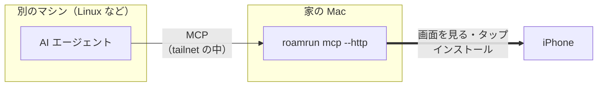

家の Mac 以外のマシンから iPhone を使う形は 2 つあります。家の Mac の RoamRun を窓口にする形（この節）と、`roamrunctl` で iPhone に直接つなぐ形（5 節）です。6 節のクラウドの例は、この 2 つを使い分けています。

Mac の `roamrun mcp` を tailnet の中へ公開すると、別のマシンにいるエージェントも家の Mac を通して同じツールで iPhone を操作できます。

```sh
roamrun mcp --http 9090 --allow tag:agents --allow-install
```

`--allow` では呼び出しを受け付けるマシンを決めます。Tailscale の管理画面でマシンに付けたタグ（例では `tag:agents`）か、マシンの持ち主のログイン名で指定します。`--allow-install` を付けると、相手のマシンが .ipa をアップロードしてインストールできます。公開している間は、許可したマシンのどのプログラムからでも操作できます。

tailnet の Linux マシンからスクリプトで呼び出して、アップロード、インストール、起動まで動くことを確かめました。

:::details トークンと呼び出し先
`--token-file <ファイル>` を付けると、どのリクエストにも `Authorization: Bearer <トークン>` を求めます。トークンは 32 文字以上で、ファイルは自分だけが読めるようにしておきます。

呼び出し先は `http://<Mac の Tailscale の IPv4 アドレス>:<ポート>/mcp` です。クラウドの環境にはふつう MagicDNS（tailnet の機器を名前で引ける仕組み）がないので、名前ではなくアドレスを渡します。

`--allow-install` を付けると、相手は .ipa を 2 段階で入れます。まず `PUT /upload` で .ipa を送ります（既定で 1024 MiB まで）。家の Mac の RoamRun はアップロードの id とファイルの sha256 を答えるので、`install` ツールにその 2 つを渡して入れます。公開をやめるときは、`roamrun mcp --http` を Ctrl-C で止めます。
:::

## 5. Xcode のないマシンから iPhone を使う

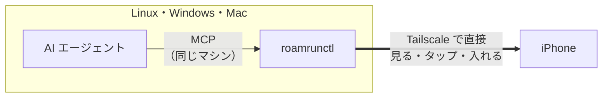

`roamrunctl` は RoamRun を入れていないマシン向けのコマンドです。Linux、Windows、macOS で動き、Xcode も要りません。`roamrunctl` を動かすマシンが、直接 iPhone とつながります。まず、そのマシンで `roamrunctl pair control` を使って iPhone とペアリングします。同じ Wi-Fi で直接でも、iPhone のそばのマシンの仲介でも構いません（仲介できるのは、どれかの Mac と一度でもペアリングしたことのある iPhone です）。そのあとは、スクリーンショットを撮ったり、アプリを入れて起動したりできます。MCP のサーバーとして動かせば、そのマシンのエージェントがタップや文字入力もできます。入れ方と使い方は、[roamrunctl の README](https://github.com/mh-mobile/RoamRun/blob/main/Rust/roamrunctl/README.ja.md) にあります。

root がないマシンでは、Tailscale を userspace で動かします。その Tailscale は同じマシンに HTTP プロキシを出すので、それを環境変数 `ROAMRUNCTL_PROXY` で指定します（0.10.0 以降）。roamrunctl は、このプロキシの CONNECT で tailnet への TCP をそのまま通します。10 節の Xcode Cloud と Bitrise は、この形です。Codex Cloud のプロキシのように、HTTP の要求しか運ばないものは使えません（6 節）。

## 6. クラウドのエージェントから使う

クラウドで動くエージェントからも、手元の iPhone を使えます。ここでは、Codex Cloud、Grok Bot、Devin Cloud で試した例を紹介します。クラウドのマシンから iPhone を見て操作する形は、Codex Cloud と Grok Bot です。この形では、やり取りするもの（画面の画像、入力した文字、アップロードした .ipa、MCP のトークン）が、すべてそのクラウドのサーバーや間にあるプロキシを通ります。ペアリングのファイルをクラウドに渡すと（Grok Bot の例の 1 つ目）、そのコピーが残ることもあります。クラウドの Mac を使う形（Devin Cloud）では、Xcode のペアリングがその Mac に残ります（詳しくは「鍵とトークンの扱い」）。

### Codex Cloud：roamrunctl の MCP を tailnet に公開する

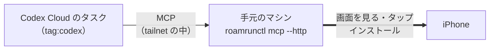

4 節では RoamRun の入った Mac が窓口でした。5 節の `roamrunctl` も、同じように tailnet の中へ公開できます（10 節の CI の relay も、この `roamrunctl mcp --http` です）。試した Codex Cloud の環境では、タスクから外へ出られるのは HTTP だけで、iPhone に直接つなぐことはできません。そこで、手元のマシンを窓口にします。エージェントのマシンを tailnet に入れ、手元のマシンで次を動かしておきます。

```sh
roamrunctl mcp --http 9090 --allow tag:codex --allow-install iphone
```

`iphone` は、`roamrunctl pair control` で保存した iPhone の名前です。Codex Cloud のタスクから、画面を見てタップし、.ipa を入れて起動するまで通りました。

:::details Codex Cloud 側の準備と試した記録
- Codex のマシンには MagicDNS がないので、手元のマシンが Tailscale で持つ IPv4 アドレスで呼びます。
- Codex の環境のネットワーク設定でそのアドレスへの通信を許可しておきます。
- Codex のタスクの通信は、その環境の HTTP プロキシ（`proxy:8080`）を通ります。このプロキシは HTTP を運びますが、ほかの TCP は通しません。TCP を通すほうのプロキシ（`proxy:8088`）には、利用者が設定できない許可が要ります。2026 年 10 月 14〜15 日には、Codex のタスクの roamrunctl から iPhone へ直接つなぐことも試しました。`ROAMRUNCTL_PROXY` を入れた開発中のビルドに `proxy:8080` を渡しましたが、通りませんでした。
- このプロキシは TLS も自分で終端します。HTTPS にしても、やり取りするもの（画面の画像、入力した文字、アップロードした .ipa、MCP のトークン）は OpenAI の側から見えます。
- 試したときの Tailscale の auth key は、Reusable と Ephemeral にしたタグ付きのものです。Tailnet Lock（新しい機器の参加に、信頼した機器の署名を求める設定）を有効にしている tailnet では、auth key に署名が要ります。

2026 年 10 月 19 日に、roamrunctl 0.8.0 のリリース前のビルドで試しました。Codex Cloud のタスクのマシンを `tag:codex` として tailnet に入れ、手元の Mac と Linux の仮想マシンでそれぞれ上のコマンドを動かしました。どちらでも、Codex が画面を見てタップするところから、.ipa のアップロード、インストール、起動まで通りました。
:::

Mac アプリの `roamrun mcp --http`（4 節）を Codex Cloud から呼んだことは、まだありません。

### Grok Bot：Linux でビルドして音声入力で操作を頼む

SpaceXSI（旧 SpaceXAI、xAI）の Grok Bot は、クラウドのコンピューターでコマンドを実行できるエージェントです。そのコンピューター（Debian 13、x86_64）を使って、2 つのことを試しました。

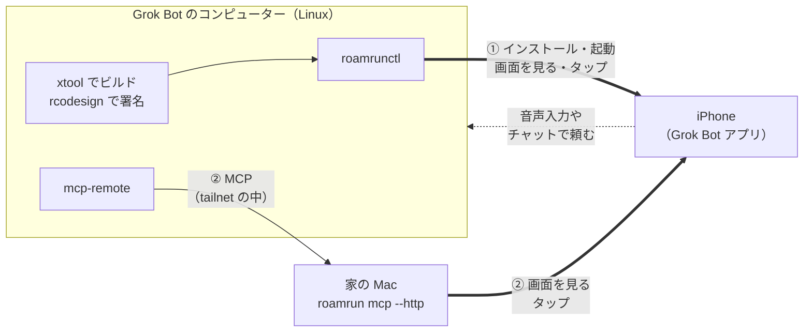

**1 つ目（図の①）は、Linux でビルドしたアプリを入れること**です。ビルドと署名には Mac を使わず、Xcode も動かしていません。Xcode からは、SDK だけを Linux に置いて使いました。iPhone とのペアリングには、家の Mac で作ったファイルを Grok に渡しました。xtool（Linux などで iOS アプリをビルドするツール）でビルドしたアプリを roamrunctl でインストールすると、9 秒で起動まで済みました。Grok は続けて画面を見てボタンを押し、表示が変わったことを確かめました。

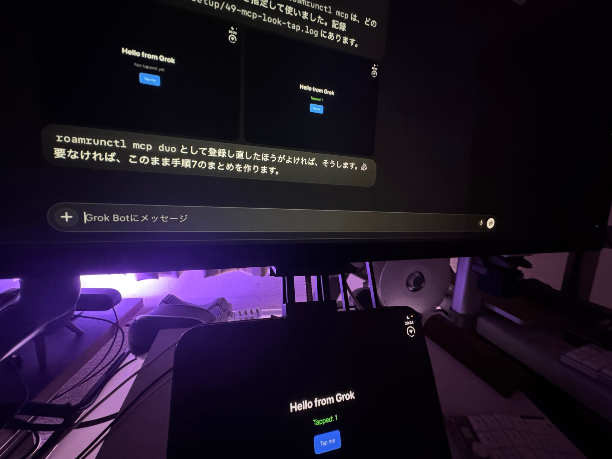

**2 つ目（図の②）は、iPhone の Grok Bot アプリから頼んで、その iPhone を操作してもらうこと**です。Grok は mcp-remote（標準入出力の MCP を HTTP の MCP サーバーにつなぐツール）で、家の Mac の `roamrun mcp --http`（4 節）を呼びます。キーボードの音声入力で頼むと、Grok は 1 つ目で入れたアプリ HelloGrok を開き、ボタンを 3 回押しました。

:::details 試した手順
**1 つ目。** アプリは Grok のコンピューターの上で、xtool がビルドし、rcodesign が署名しました。その手順は、[omarchy-apple-dev](https://github.com/joshuaswarren/omarchy-apple-dev) のスクリプトに任せました。iPhone とのペアリングには、家の Mac で作ったファイル（`roamrun key create`）を使いました。これを Grok にアップロードし、`roamrunctl key import` で取り込んだものが、次のコマンドの `duo` です。`roamrunctl install duo HelloGrok.ipa --launch` で入れて起動しました。続けて roamrunctl の MCP で画面を見てボタンをタップし、もう一度見ると、表示は「Not tapped yet」から「Tapped: 1」に変わっていました。

**2 つ目。** 1 つ目で渡したペアリングのファイルは、Grok の保管場所から消せません。早く取り消したいので、2 つ目では Grok に渡したペアリングを使わず、mcp-remote で家の Mac の `roamrun mcp --http` を呼ぶ形にしました。iPhone とのペアリングは Mac のものを使いました。Grok に渡したペアリングは、試しが終わってから iPhone のデベロッパモードの一覧で削除しました。

iPhone の Grok Bot アプリには、キーボードの音声入力で「HelloGrok を開いて、Tap me を 3 回押して」と頼みました。Grok は HelloGrok を開いて 3 回タップし、表示は「Tapped: 3」になりました。Mac の Grok Bot アプリからチャットで頼んだときも、結果は同じでした。
:::

:::message
2 つ目の形（Mac の RoamRun を通す）では、Grok Bot アプリの音声モード（アプリと声で会話するモード）で話している間、画面を見られませんでした。Mac の RoamRun は、iPhone に画面共有のストリームを始めてもらって画面を見ます。iPhone は、そのストリームの音声を始めるところで、電話か VoIP の通話中だというエラーを返して断りました。音声モードは、通話と同じ扱いでマイクを使い続けているようです（確かめてはいません）。ただ、話し終えたらすぐに音声モードを閉じると、そのあとの操作は進みました。キーボードの音声入力なら、文字になったあとの操作もそのまま進んだので、音声モードを終える手間もありません。1 つ目の形（Linux の `roamrunctl`）では、画面はもともと PNG のスクリーンショットで見るので、画面共有は使いません（音声モードの最中には試していません）。
:::

:::details つまずいたところと使った版
こうしたクラウドのコンピューターならではの壁が 3 つありました。

- **apt が Debian のミラーに届かない。** apt は接続の前に、DNS の SRV レコードを引きます。このコンピューターの DNS（Tailscale の 100.100.100.100）では、SRV レコードが外向きのプロキシを指していて、そこで接続が切られていました。`/etc/apt/apt.conf.d/` に `Acquire::EnableSrvRecords "false";` を置くと通りました。
- **App ID とプロファイルを作れない。** xtool のサインインには、App Store Connect の API キーを使いました。ただ、Developer の役割で作ったキーでは、開発用の証明書は作れても、App ID の登録とプロファイルの作成は断られました。どちらも、Apple Developer のサイトから手で作りました。キーのファイルは Grok にアップロードして渡しましたが、これも Grok の保管場所から消せませんでした。
- **署名のタイムスタンプのサーバーに届かない。** 開発用のビルドにはタイムスタンプは要らないので、付けずに署名しました。

使った版は次のとおりです。

- Grok のコンピューター：Debian 13（x86_64）、Tailscale 1.104.2、roamrunctl 0.11.0、xtool 1.24.0、rcodesign（apple-codesign 0.29.0）、Swift 6.4.1、Xcode 27.2 RC の SDK、mcp-remote 0.15.2
- 家の Mac：RoamRun 0.11.0
- iPhone：iPhone Duo（iOS 27.2）

試した日は 2026 年 10 月 27 日です。
:::

### Devin Cloud：クラウドの Mac の Xcode で手元の iPhone をデバッグする

Devin Cloud は、Cognition のエージェント Devin をクラウドの仮想マシンで動かすもので、2026 年 9 月から Mac の環境も使えます。Devin の Mac（仮想マシン）から、家にある iPhone のアプリを Xcode でデバッグするところまで試しました。

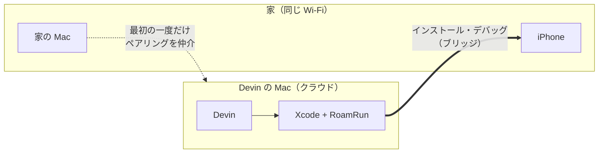

Devin の Mac に RoamRun を入れて、家の Mac の仲介で iPhone とペアリングし、ブリッジを始めました。すると Devin の Mac では、Xcode の実行先に iPhone（名前は iPhoneDuo）が出ました。Devin が作ったアプリ（HelloDevin）は iPhone で起動しました。そのあと Devin が自分の Mac の画面で Xcode を操作してブレークポイントを置き、Run すると、iPhone でボタンを押したところで止まりました。

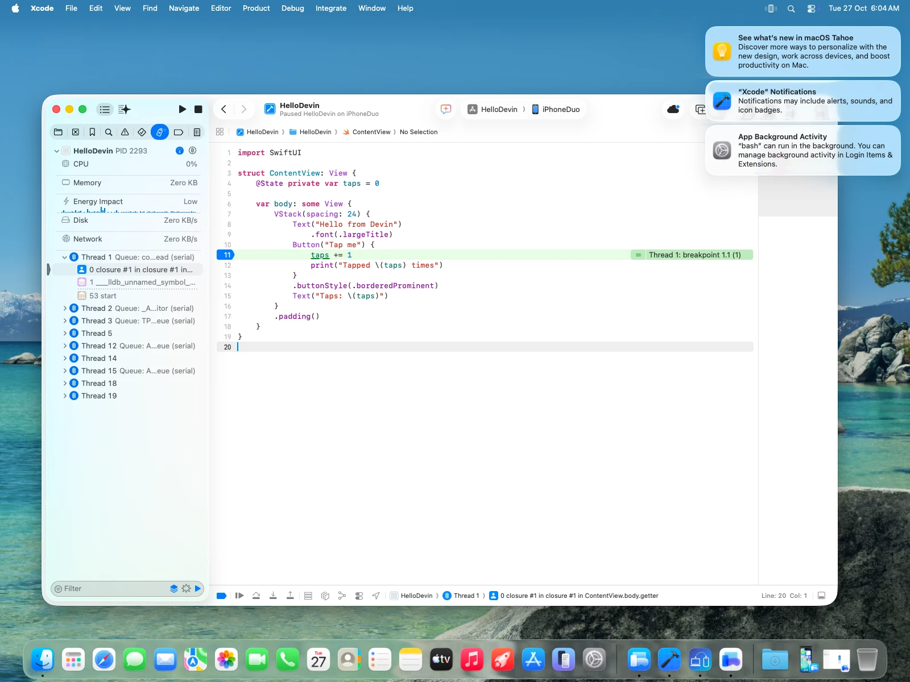

:::details 試した流れ
1. Devin の Mac で、RoamRun のリポジトリの `scripts/set-up-mac.sh` を実行して、Tailscale、RoamRun、エージェント用のスキルを入れました。何もない Mac を用意する手順は、[docs/another-mac.md](https://github.com/mh-mobile/RoamRun/blob/main/docs/another-mac.md)（英語） にあります。
2. Devin の Mac の Xcode には、Apple アカウントでサインインしておきました（署名に要ります）。
3. 2 節の流れで、Devin の Mac を iPhone とペアリングしました。仲介したのは、iPhone と同じ Wi-Fi にいる家の Mac です。Device Hub に出たコードは、Devin のデスクトップの画面で読みました。
4. Devin の Mac で `roamrun up iPhoneDuo -d`（`-d` はバックグラウンドで始める）を実行すると、18 秒で「Ready for Xcode」になりました。`iPhoneDuo` は、Devin の Mac に保存された iPhone の名前です。

   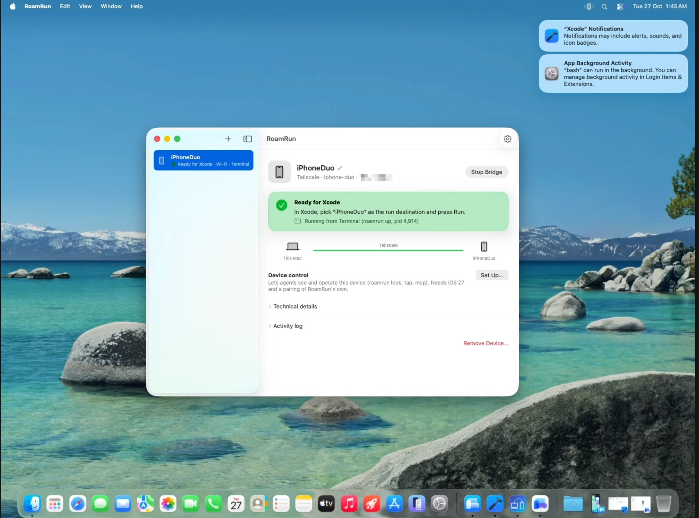

5. Devin がアプリ（HelloDevin）を作って、`roamrun run iPhoneDuo` で iPhone に入れて起動しました。実機向けのビルドだけなら 10 秒、`roamrun run`（ビルド、インストール、起動をまとめて行う）は 62 秒でした。Devin の Mac の Xcode でも、実行先の一覧に iPhoneDuo が出ていました。

   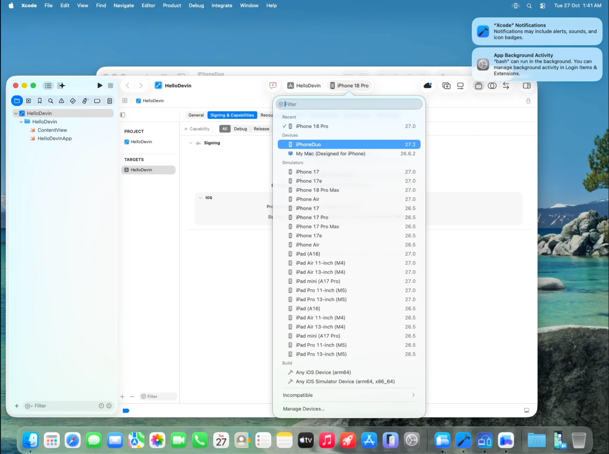

   

6. Devin が Xcode でボタンの処理にブレークポイントを置いて Run し、私が iPhone でボタンを押すと、その行で止まりました（この例の最初の画像）。
:::

:::message
最初のデバッグの前に、Xcode が iPhone から OS のシンボルをコピーします。今回は Tailscale の中継サーバー経由で、3 時間 16 分かけて 93%（約 7.1 GB）まで進んだところで、iPhone がモバイル通信に移りました。ブリッジはトンネルを閉じ、コピーも止まりました（モバイル通信でもセッションを保つ設定 Keep debugging on cellular はオフでした）。この設定は、1 節の折り畳みで説明しています。Wi-Fi に戻して Run し直すと続きから再開し、残りは約 6 分で済みました。同じ iOS のシンボルを持つ Mac があれば、この待ちは省けます。`~/Library/Developer/Xcode/iOS DeviceSupport/` の該当フォルダをコピーします（[docs/far-mac.ja.md](https://github.com/mh-mobile/RoamRun/blob/main/docs/far-mac.ja.md)）。
:::

:::details 途中で起きたことと使った版
- `set-up-mac.sh` の 1 回目は、途中で失敗しました。Devin がシェルに `umask 077` を設定していたことが一因です。
- RoamRun を開くところでは、入れたばかりのアプリを名前で開けず、パスを指定すると開けました（`open -g /Applications/RoamRun.app`）。
- 1 回目のペアリングは、家の Mac の Tailscale から iPhone に直接届かず（`pair introduce` がそう表示しました）、仲介が始まりませんでした。2 回目で通りました。
- iPhone のデベロッパモードの一覧には、Devin の Mac が「Apple Virtual Machine 1」という名前で出ました。仮想マシンのコンピュータ名です。

使った版は次のとおりです。

- Devin の Mac：macOS 26.6.2（仮想マシン）、Xcode 27.0 RC、RoamRun 0.11.0、Tailscale 1.104.2
- 家の Mac：RoamRun 0.11.0
- iPhone：iPhone Duo（iOS 27.2）

試した日は 2026 年 10 月 27 日です。
:::

## 7. 手元の仮想マシンのエージェントから使う（Tart の例）

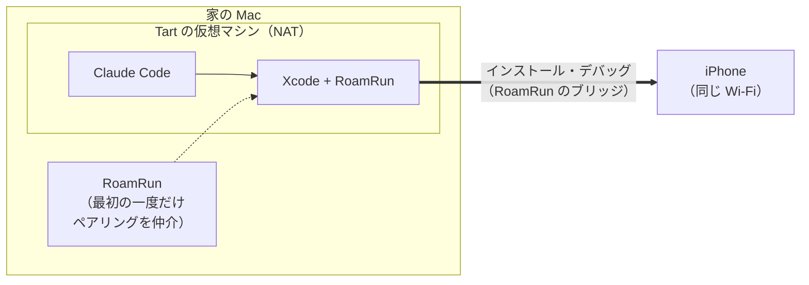

エージェントに権限を広く渡すときは、ふだん使う Mac から切り離して、仮想マシンの中で動かしたいことがあります。ただ、[Tart](https://tart.run/) の macOS の仮想マシンは既定の設定ではネットワークが NAT なので、同じ Wi-Fi にいる iPhone でも中の Xcode からは見えません。2 節のペアリングと RoamRun のブリッジを使うと、仮想マシンの中の Xcode とエージェントから iPhone を使えます。家の中でも RoamRun が要る場面です。ここでのブリッジは RoamRun の機能で、Tart のネットワークの設定にあるブリッジ接続（`--net-bridged`）とは別のものです。Tart のブリッジ接続は試していません。

Apple Container や Docker のコンテナも、エージェントを閉じ込める場所になります。ただし中身は Linux なので、Xcode は動きません。使うなら 5 節の `roamrunctl` で、コンテナの中で Tailscale を userspace で動かし、`ROAMRUNCTL_PROXY` を通す形になるはずです。コンテナでは試していません。

家の Mac で動かした Tart の仮想マシンで試しました。仮想マシンの中で Bonjour で iPhone を探しても（`dns-sd -B _remotepairing._tcp` を 8 秒）、家の Mac で見えていた 3 件は出てきませんでした。仮想マシンを tailnet に入れ、家の Mac の仲介で iPhone とペアリングしてブリッジを始めると、4 秒で「Ready for Xcode」になりました。仮想マシンの中の Claude Code が作ったアプリ（HelloTart）は、`roamrun run` で iPhone に入り、Xcode のブレークポイントでも止まりました。

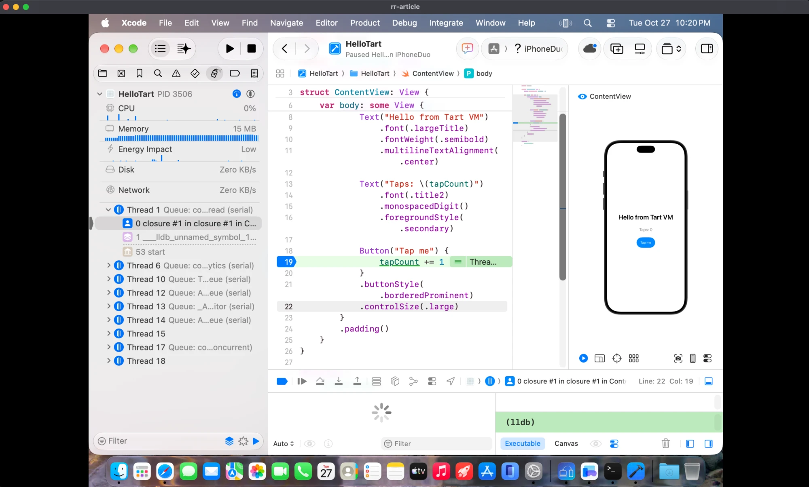

:::details 試した流れ
1. 仮想マシンを tailnet に入れました。auth key はタグなしで、Tailnet Lock 用に署名したものです。仮想マシンから iPhone へは、中継サーバーを通らず LAN で直接つながっていました。
2. 2 節の流れで、仮想マシンを iPhone とペアリングしました。仮想マシンで `roamrun pair xcode --with macbook-pro`、家の Mac で `roamrun pair introduce --host manageds-virtual-machine --to iPhoneDuo` を実行しました。iPhone のデベロッパモードの一覧で仮想マシンを選び、仮想マシンの Device Hub に出たコードを入れました。
3. 仮想マシンで `roamrun up iPhoneDuo -d` を実行すると、4 秒で「Ready for Xcode」になりました。仮想マシンの `devicectl` にも、iPhoneDuo が `connected` で出ました。

   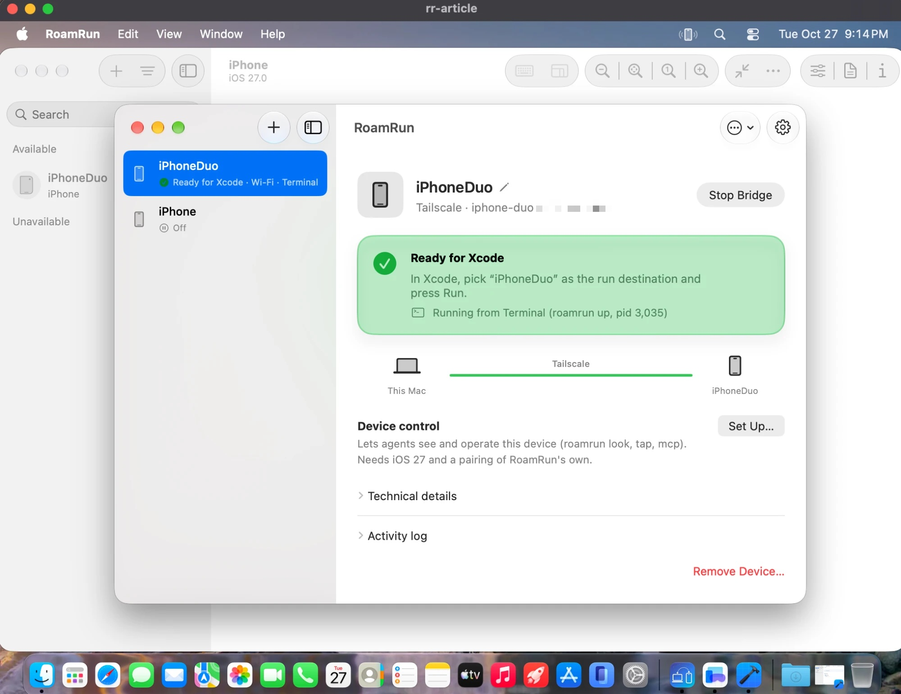

4. 仮想マシンの Claude Code に RoamRun のスキルを入れ（`roamrun init`）、アプリ（HelloTart）を作らせました。`roamrun run iPhoneDuo` は、最初のビルドと署名を含めて約 70 秒でした。仮想マシンの Xcode には、前から Apple アカウントでサインインしてありました。iPhone は開発用のプロファイルに入っていませんでしたが、そのアカウントで開発用のデバイスに自動で登録され、途中で止まりませんでした。
5. シンボルを入れ替えたあと（下の注意）、仮想マシンの Xcode でボタンの処理にブレークポイントを置いて Run し、iPhone でボタンを押すと、その行で止まりました（この例の最初の画像）。

使った版は次のとおりです。

- 仮想マシン：Tart 2.40.1、macOS 27.0（Cirrus Labs の Xcode 入りのイメージ）、Xcode 27.0、RoamRun 0.11.0、Tailscale 1.102.4、Claude Code 2.1.267
- 家の Mac：RoamRun 0.11.0
- iPhone：iPhone Duo（iOS 27.2）
:::

:::message
6 節の Devin Cloud と同じく、最初のデバッグの前に Xcode が iPhone から OS のシンボルをコピーします。ブリッジ越しでは毎秒 2 MB 前後で、全部で 1 時間ほどかかる見込みでした。そこで、iPhone をケーブルで家の Mac につないで、家の Mac の Xcode にコピーさせると、約 4.5 分で済みました。できたフォルダ（約 7 GB）は `~/Library/Developer/Xcode/iOS DeviceSupport/iPhone19,4 27.2 (24B91020)` です。これを `tar` と `tart exec -i` で仮想マシンの同じ場所にコピーすると、101 秒で済みました。仮想マシンの Xcode によるブリッジ越しのコピーは、Run を止めても Xcode を終了しても裏で続いたので、入れ替える前に `roamrun down` でブリッジを止めました。
:::

## 8. スマートグラスの音声入力で頼む（Even G2 の例）

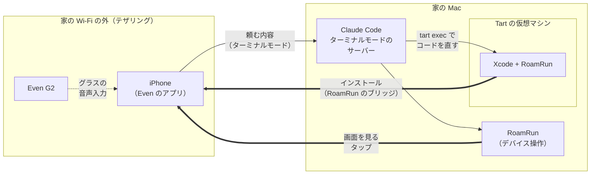

[Even G2](https://www.evenrealities.com/) は、Even Realities のスマートグラスで、レンズの中に表示が出ます。公式アプリの[ターミナルモード](https://evenrealities.com/terminal)を使い、Even が配るサーバーを家の Mac で動かすと、Claude Code や Codex にグラスの音声入力で指示できます。7 節の仮想マシンと組み合わせて、家の Wi-Fi から外した iPhone のアプリを、音声入力だけで直して動かすところまで試しました。


iPhone は別の iPhone のテザリングにつないで、家の Wi-Fi から外しました。グラスとつなぐ Even のアプリは、テザリングを出す iPhone ではなく、HelloTart を動かす（操作される）ほうの iPhone に入れてあります。家の Mac から iPhone への経路は、Tailscale の中継サーバー経由でした。ターミナルモードのサーバーは家の Mac で動かしたので、Claude Code も家の Mac で動き、仮想マシンには `tart exec` で入りました。この形では、7 節のようにエージェントを仮想マシンに閉じ込めてはいません。

まず、グラスに向かって、HelloTart（7 節で入れたアプリ）の「Tap me」を 3 回押すように頼みました。すると Claude Code は、家の Mac にある RoamRun のデバイス操作で画面を見ながらアプリを開いて 3 回押しました。続く依頼は、派手なアニメーションの追加です。Claude Code は Tart の仮想マシンに入ってコードを書き換え、仮想マシンのブリッジ越しに iPhone へ入れ直しました。最初の依頼から最後の 10 回ほどの連打まで、頼み方はすべてグラスの音声入力でした。


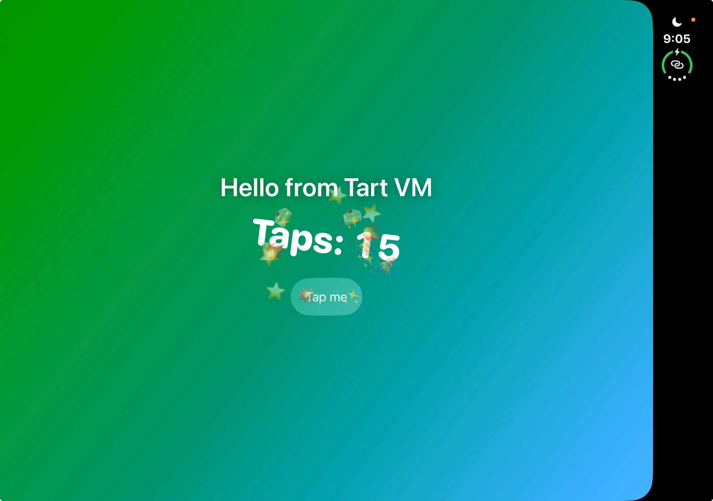

:::details 試した流れ
1. HelloTart を開いて「Tap me」を 3 回押すように頼みました。Claude Code は `roamrun look`、`swipe`、`type`、`tap` で Spotlight から HelloTart を開き、3 回押して「Taps: 3」を確かめました。3 節の MCP と同じ操作は、`roamrun` のコマンドにもあります。
2. 仮想マシンの Xcode でビルドして入れるように頼みました。Claude Code は `tart exec` で仮想マシンに入り、`xcodebuild` でビルドして、`devicectl` で iPhone に入れて起動しました。インストールは、仮想マシンのブリッジ（7 節）を通りました。
3. 派手なアニメーションを足すように頼むと、Claude Code はグラデーションの背景、タップごとに膨らんで揺れる数字、飛び散る絵文字、振動を足しました。同じ手順で入れ直したあと、Claude Code が 1 回押すと、背景の色が変わりました。飛び散る絵文字は Claude Code が撮った画面には写らず、私が手元の iPhone で見て確かめました。振動は確かめていません。
4. 10 回ほど連打するように頼むと、Claude Code は `look` と `tap` を 10 回続け、10 回ともエラーは返りませんでした。押す前に毎回画面を見るので、1 回あたり 1 秒弱かかり、指で押すより遅くなります。

試した日は 2026 年 10 月 28 日です。
:::

## 9. テスターが Mac なしでアプリを入れる

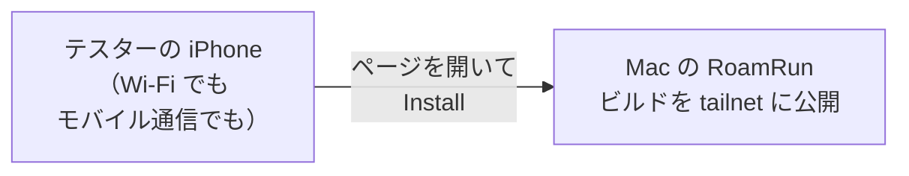

`roamrun ota` は tailnet の中のページにビルドを公開します。iPhone でそのページを開いて Install をタップすると、iPhone が自分でビルドを入れます。テスターの iPhone にも Tailscale を入れて、同じ tailnet に入ってもらいます。

```sh
roamrun ota build/MyApp.ipa
```

入れられるのは、Ad Hoc か Enterprise 用に署名した .ipa です（Development のビルドは受け付けません）。Ad Hoc のビルドは、インストール先の iPhone が、プロビジョニングプロファイルに含まれている必要があります。ブリッジもペアリングも要らず、モバイル通信でも使えます。次のような場面に向いています。

- ほかの人の iPhone（この Mac とペアリングしたことがない）に入れたい
- テスター向けの Ad Hoc ビルドを配る前に自分で試したい
- 同じ tailnet のチームメンバーに Mac なしでインストールしてもらいたい

できるのはインストールだけで、デバッガは使えません。

## 10. CI のジョブから実機にアプリを入れて起動する

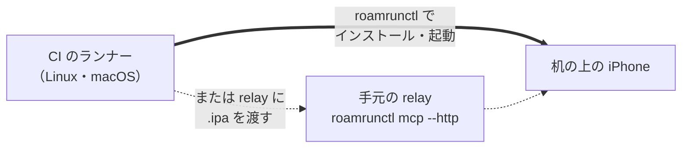

5 節の `roamrunctl` を使うと、CI のジョブから Tailscale 越しに署名済みの .ipa を実機へ入れて起動できます。Linux のランナーでもできます。

CI から入れるには、デバイス操作のペアリングが要ります。3 節と同じ種類のもので（Xcode のペアリングではありません）、CI 用に新しく作ります。作るのは iPhone と同じ Wi-Fi のマシンで、Mac なら `roamrun key create`、どのマシンでも `roamrunctl pair control --to` を使います。その置き場所は 2 通りから選べます。1 つは、CI のシークレットに置いてランナーから直接入れるやり方です（ランナーは `roamrunctl key import` で取り込みます）。もう 1 つは、ペアリングを持つ手元のマシン（図の relay。Tailscale の中継サーバーとは別のものです）に .ipa を渡して入れてもらうやり方です。

relay では `roamrunctl mcp --http` を動かしておきます。relay は、起動時に `--token-file` で渡したトークンで呼び出しを確かめます。CI のマシンは Tailscale の auth key（tailnet に参加するための鍵）か OAuth クライアントで tailnet に参加します。CI のシークレットには、Tailscale の認証情報に加えて、直接入れるならペアリングを、relay に頼むなら relay のトークンを置きます。relay に頼むときは、ペアリングは relay に置きます。

:::details Tailscale のタグと relay の用意
CI のマシンは、タグを付けて tailnet に参加します。ここではタグを `tag:ci` とします。タグは Tailscale のポリシー（tagOwners）で作り、OAuth クライアントか auth key に付けます。relay に頼むときは、relay を `--allow tag:ci` で起動して、そのタグのマシンからの呼び出しだけを受け付けます。

```sh
roamrunctl mcp --http 9090 --allow tag:ci --token-file ~/.config/roamrunctl/ci-token --allow-install iphone
```

`iphone` は、relay で `roamrunctl pair control` を使って保存した iPhone の名前です。relay は、ここに挙げた iPhone だけを使わせます。

tailnet のポリシーが「すべて許可」のままだと、ジョブが動いている間、CI のマシンは tailnet のどのマシンにも届きます。絞るなら `tag:ci` の grants を書きます。relay に頼むなら、届く先は relay のポート 1 つで足ります。CI のマシンから直接入れるなら、iPhone の TCP ポートを実質すべて許可することになります。こうして絞ったポリシーは、まだ試していません。

ペアリングの作り方とタグの細かい設定は、[docs/ci.ja.md](https://github.com/mh-mobile/RoamRun/blob/main/docs/ci.ja.md)にあります。
:::

3 つの CI で試しました。どれも相手は iPhone 15 Pro（iOS 27.0）です。

### GitHub Actions

Tailscale の action で tailnet へ入ったあとに [mh-mobile/roamrun-action](https://github.com/mh-mobile/roamrun-action) を置きます。Linux と macOS のランナーで動きます。試した tailnet（MagicDNS がオン）の macOS のランナーでは、DNS を戻す必要がありました。Tailscale の action のあとに `sudo networksetup -setdnsservers Ethernet Empty` を実行します（理由は roamrun-action の README にあります）。

```yaml
- uses: mh-mobile/roamrun-action@v1
  with:
    key: ${{ secrets.ROAMRUN_CI_KEY }}
    ipa: build/MyApp.ipa
```

`key` には、CI 用に作ったデバイス操作のペアリングを入れたシークレットを渡します。relay に頼むときは、`key` の代わりに `relay`、`token`、`device` を書きます。既定ではインストールしてから起動します。`ubuntu-24.04` のランナーから、どちらのやり方でもインストールと起動まで通りました。手順は [docs/ci.ja.md](https://github.com/mh-mobile/RoamRun/blob/main/docs/ci.ja.md) にあります。

### Xcode Cloud

Xcode Cloud では、プロジェクトのスクリプト（`ci_scripts/ci_post_xcodebuild.sh`）で Tailscale を root なしの userspace で動かします。Tailscale が出す HTTP プロキシを `ROAMRUNCTL_PROXY` で渡せば、roamrunctl はそれを通って tailnet に届きます（0.10.0 以降）。

```bash
# 抜粋です。--socket などのオプションを含む全体は docs/xcode-cloud.ja.md にあります
tailscaled --tun=userspace-networking --outbound-http-proxy-listen=127.0.0.1:1056 &
# tailscale up で tailnet に参加（省略）
# $ipa は開発用に署名して書き出された .ipa（CI_DEVELOPMENT_SIGNED_APP_PATH）
export ROAMRUNCTL_PROXY=http://127.0.0.1:1056
printf '%s' "$ROAMRUN_KEY" | roamrunctl key import - --as dev
roamrunctl install dev "$ipa" --launch
```

試したときは、アーカイブのあとにインストールして起動するまで、relay に頼むやり方では 10 秒、ペアリングを置くやり方では取り込みから 14 秒でした。このときの roamrunctl は 0.10.0 のリリース前のビルドをリポジトリに入れたもので、リリースのアーカイブを取ってくる形はまだ試していません。スクリプトは [docs/xcode-cloud.ja.md](https://github.com/mh-mobile/RoamRun/blob/main/docs/xcode-cloud.ja.md) にあります。

### Bitrise

Step の [mh-mobile/bitrise-step-roamrun](https://github.com/mh-mobile/bitrise-step-roamrun) を使います。Bitrise の Step Library には Tailscale の Step がなかったので、この Step が自分で tailnet に参加します。Tailscale は root なしの userspace で動かし、そのプロキシを `ROAMRUNCTL_PROXY` で roamrunctl に渡します。Step 自体も Step Library にはないため、`bitrise.yml` に git の URL とタグで書きます。

```yaml
- xcode-archive@6:
    inputs:
      - distribution_method: development
      - automatic_code_signing: api-key
- git::https://github.com/mh-mobile/bitrise-step-roamrun.git@1.1.0:
    inputs:
      - tailscale_auth_key: $TS_AUTHKEY
      - roamrun_key: $ROAMRUN_KEY
```

bitrise.io で Xcode Archive & Export のあとに置いたときは、Tailscale への参加からインストールと起動まで、Step 全体で 21 秒でした。このときの Step は 1.0.0 より前のもので、roamrunctl もリリース前の 0.10.0 を渡しました。リリース後に 1.0.0 で roamrunctl を既定どおりダウンロードさせた回（Archive なし）は 27 秒でした。手順は [docs/bitrise.ja.md](https://github.com/mh-mobile/RoamRun/blob/main/docs/bitrise.ja.md) にあります。

## 想定例：TestFlight も OTA も使えないアプリを出先で入れる

以下は、1 節と 2 節を組み合わせた例です。一連の流れは、まだ通しで試していません。

Mac を家に置いたまま iPhone や iPad だけを持って出かけた場面を考えます。開発中のアプリを出先で入れたくなったとします。そのアプリは Apple の許可が要る機能を使っていて、配布用の Entitlement はまだ許可されていません。そのため、いつもは家の Mac から直接ビルドして入れています。

この場合、TestFlight も OTA（9 節）も使えません。その機能を入れたままでは、TestFlight や Ad Hoc 用のビルドを作れないためです。`roamrun ota` も Development ビルドは受け付けません。使えるのは、家の Mac の Xcode から Development ビルドを入れるいつもの方法です。それをブリッジで外まで延ばします（1 節）。

**家の Mac に RoamRun を用意してあれば**、やることは 1 節と同じです。iPhone や iPad を出先の Wi-Fi（ホテルの Wi-Fi や別のスマートフォンのテザリングなど）につなぎます。家の Mac に SSH で入って `roamrun up <名前> -d` でブリッジを始め、プロジェクトのフォルダで `roamrun run <名前>` を実行します。`-d` を付けると、SSH を切ってもブリッジは動き続けます。家の Mac は電源を入れたまま、スリープしないように設定して、Tailscale につないでおきます。

:::details 家の Mac に RoamRun をまだ用意していなかったとき
家の Mac に RoamRun を入れて（画面共有などで）、デバイスを登録するところから始めます。登録には、ふつうは同じ Wi-Fi か USB が要ります。iOS 27（iPadOS 27）と Xcode 27 なら、2 節の仲介を使えば、出先からでも家の Mac にデバイスを保存できます。デバイスが家の Mac の Xcode とペアリング済みでも、RoamRun へ保存させるために、この仲介をもう一度通します。

仲介の道は 2 つあります。どちらでも、先に家の Mac の Xcode で Device Hub › ＋ › Pair Nearby Device を開いておきます。

- **iPhone に Introducer アプリを入れてあれば**、iPhone 自身が仲介できます。SSH で家の Mac に入り、次を実行します。

  ```sh
  roamrun pair xcode --with my-iphone
  ```

  アプリには家の Mac の Tailscale 上の名前（`home-mac`）を入力して、Introduce を押します。`--qr` を付けると QR コードがターミナルに出ますが、SSH でも画面共有でも、それを映すのは同じ iPhone です。そのカメラでは読み取れないので、名前を入力します。

- **iPad や、Introducer アプリのない iPhone では**、デバイスと同じ Wi-Fi にいる Windows や Linux のノート PC が仲介します。Introducer アプリは iPhone 専用です。手元にノート PC がなければ、この道は使えません。ゲスト用の Wi-Fi や、端末どうしが隔離された Wi-Fi（ホテルに多い）でも仲介できません。家の Mac とノート PC でそれぞれ次を実行します。

  ```sh
  # 家の Mac で
  roamrun pair xcode --with my-laptop
  ```

  ```sh
  # ノート PC で
  roamrunctl pair introduce --host home-mac --to my-ipad
  ```

`my-iphone`、`my-ipad`、`my-laptop`、`home-mac` は、それぞれの機器の Tailscale 上の名前です。

最後に、デバイスの 設定 › プライバシーとセキュリティ › デベロッパモード で家の Mac を選びます（一覧には、その Mac のコンピュータ名で出ます）。続けて、家の Mac の Device Hub に出たコードを入れます。コードは画面共有で読みます。iPhone 1 台だけのときは、同じ iPhone の画面共有でコードを読んでから、設定に戻って入力します。その間、Introducer アプリはバックグラウンドで約 30 秒しか動けないことがあるので、すぐに入力してください。

デバイスを保存すると、家の Mac のコマンドがその名前を表示します（`roamrun devices` でも確かめられます）。あとは、その名前で `roamrun up` と `roamrun run` を実行します。
:::

:::message
この想定例は、上の手順と折り畳みの中の手順を組み合わせたものです。ブリッジは iPhone と iPad で動かしていますが、折り畳みの中の手順を含め、次のことはまだ試していません。

- 2 節のペアリングと `roamrunctl` を iPad で使うこと
- すでにペアリングしてあるデバイスに同じ Mac への仲介をもう一度通すこと
- iPhone 1 台で、画面共有でコードを読みながら Introducer アプリで仲介すること
- 配布用の Entitlement が要る機能を使ったアプリで最初から最後まで通すこと
:::

## 使う前に知っておくこと

:::message
RoamRun は Apple が公開していない仕組みの上で動いています。iOS、macOS、Xcode の更新で動かなくなる可能性があります。困ったときは、まず `roamrun doctor` を実行してください。
:::

- 試した範囲は次のとおりです。ブリッジは iPhone、iPad、Apple Vision Pro で、デバイス操作と `roamrunctl` は iPhone だけで動かしています。`roamrunctl` は Linux と macOS で、画面の操作、インストール、起動まで試しました。Windows（ARM 版の Windows 11）で試したのは、仲介する側（`pair introduce`）、同じ Wi-Fi でのペアリング（`pair control --to`）、画面を見る `look` です。仲介してもらう側（`pair control --with`）、MCP、インストール、起動はこれからです。CI は 3 つとも iOS 27.0 の iPhone 15 Pro へのインストールと起動まで通りました。Flutter と React Native では試していません。
- デバイス操作、`roamrun mcp`、OTA のページは、RoamRun のアプリが起動している間だけ使えます。
- 一度もペアリングしたことのない iPhone は、仲介を始められません（2 節、5 節）。先にどれかの Mac と一度ペアリングしておきます。
- 離れた Mac でブレークポイントを使うには、デバイスの OS のシンボルが離れた Mac に要ります。6 節の Devin の例では 7 GB を超え、中継サーバー経由では何時間もかかりました。省き方もそこに書いています。7 節の Tart の例では、USB でつないだ Mac にコピーさせてから仮想マシンへ運びました。
- `roamrunctl` 自体はビルドも署名もしません。
- OTA には tailnet の MagicDNS と HTTPS 証明書を有効にしておく必要があります。tailnet のメンバーなら、だれでもページを開いてインストールできます。
- Safari の Web インスペクタは、ブリッジ越しだと接続がたびたび切れます。

## 鍵とトークンの扱い

:::message alert
この記事に出てくる鍵やトークンの中には、持っている人が iPhone を使えるようになるものがあります。どれもパスワードと同じように扱ってください。漏れた疑いがあるときの取り消し方は、この節の「取り消し方」にあります。
:::

- **Mac の RoamRun が持つデバイス操作のペアリング。** 暗号化して保存され、暗号化に使う鍵はログインキーチェーンにあります。スイッチがオンの間は、その Mac で動くどのプログラムからでも使えます。iPhone をロックしても（スリープするまでは）操作は止まらず、ロック画面も見えて操作できます。止めるのはスイッチです。使わないときはオフにします。
- **ペアリングのファイル（`roamrun key create` で作るもの。10 節の CI のシークレットに置くこともあります）。** ファイルは本人だけが読めますが、暗号化はされていません。ファイルを持っていて、ネットワークで iPhone につながれる人なら、だれでも使えます。運んだ先で `roamrun key import`（Mac）か `roamrunctl key import`（RoamRun のないマシン）を実行すると、取り込んだうえでファイルを消します。コピーを残さないでください。
- **`roamrunctl` のペアリング。** 設定フォルダのファイルで、本人だけが読めます。同じユーザーで動くプログラム（エージェントも含みます）は、すべてこれを使えます。`--passphrase` を付けると、ファイルをパスフレーズで暗号化できます。
- **`mcp --http` のトークン。** `--token-file` のファイルは本人だけが読めるようにし、トークンは 32 文字以上にします。許可したマシンからトークンを付けて呼べば、だれでも操作できます。サーバーを止めるか、新しいトークンで起動し直すと、そのトークンは使えなくなります。クラウドから呼ぶときは、やり取りするもの（画面の画像、入力した文字、アップロードした .ipa、トークン）が、間にあるプロキシから見えます。
- **Tailscale の auth key と OAuth クライアント。** auth key を持っている人は、期限が切れるか取り消されるまで、そのタグで tailnet に参加できます。OAuth クライアントは取り消すまで使えます。Tailnet Lock で署名した auth key は、署名ノードの承認なしで参加できるので、漏れたときの影響が大きくなります。期限は短くして、漏れた疑いがあれば管理画面で取り消します。
- **CI のシークレット。** ペアリングや relay のトークンを置いたシークレットは、それを読むワークフローを動かせる人なら、だれでも使えます。
- **Xcode のペアリング（2 節）。** ペアリングした Mac は、アプリのインストール、実行、デバッグ、アプリのデータの読み取りができます。RoamRun からはオフにできません。借りた Mac やクラウドの Mac では、ペアリングがそのディスクやイメージに残ります。使い終えたら iPhone 側で削除し、その Mac の Xcode からも Apple アカウントを外します。

### 取り消し方

ペアリングを取り消すには、iPhone 側と手元側の両方で消します。手元で消しても、コピーやバックアップに残った鍵は使えたままです。漏れた疑いがあるときは、必ず iPhone 側でも削除してください。

**iPhone 側**（どのペアリングもここで取り消せます）

手順は iOS 27.2 で確かめました。

1. 設定 › プライバシーとセキュリティ › デベロッパモード を開きます。
2. 一覧から取り消したい項目を選んで、ペアリングを解除します。項目の名前は作り方で変わります。
   - Mac の RoamRun で Set Up したデバイス操作：「RoamRun (その Mac の名前)」
   - `roamrun key create` で作ったもの：`--as` に付けた名前。付けなかったときは「RoamRun (ファイル名)」（拡張子を除いた名前）
   - `roamrunctl pair control` で作ったもの（`--to` でも `--with` でも）：そのマシンの Tailscale 上の名前
   - Xcode のペアリング：その Mac のコンピュータ名。`pair introduce` で仲介したときは、その出力にも出ます。クラウドの仮想マシンでは、「Apple Virtual Machine 1」のような名前になることがあります（6 節の Devin の例）

   Xcode のペアリングは、どちらの作り方でもこの一覧に出ます（iOS 27.2 で確認）。USB でつないで「このコンピュータを信頼」したものと、Device Hub の Pair Nearby Device で作ったもの（2 節の仲介を含む）です。

**手元側**

- **Mac の RoamRun。** デバイスのページで Device control の行の Remove… を押します。RoamRun がペアリングを忘れます。iPhone の一覧の項目は残るので、上の手順でも削除します。一時的に止めるだけなら、同じ行のスイッチをオフにします。
- **`roamrunctl`。** `roamrunctl devices remove <名前>` で保存したペアリングを消します。
- **`mcp --http` のトークン。** サーバーを止めるか、新しいトークンで起動し直します。
- **Tailscale の auth key と OAuth クライアント。** Tailscale の管理画面で取り消します。auth key を取り消しても、それで参加済みの機器は tailnet に残ります。漏れた疑いがあるときは、管理画面で見覚えのない機器も確かめて削除します。

ほかに気をつけることです。

- ペアリングのコマンド（`roamrunctl pair control`、`roamrun key create`、仲介する側の `pair introduce`）は、自分のターミナルで実行します。エージェントに実行させると、入力するコードがエージェントの出力に入ります。
- ペアリングのファイル、トークン、auth key の中身は、エージェントとの会話に貼らないでください。
- エージェントのアプリにファイルをアップロードすると、アプリの保管場所にコピーが残ることがあります。6 節の Grok Bot の例では、ペアリングのファイルと App Store Connect の API キーのファイルを、Grok の保管場所から消せませんでした。渡すしかないときは、使い終わったらすぐに取り消します。ペアリングは iPhone 側で、API キーは App Store Connect で取り消します。
- tailnet をほかの人と共有しているなら、Tailscale のアクセス制御で iPhone や MCP のサーバーに届くマシンを絞ります。

## よくある質問

:::details モバイル通信だけでも使えますか
ブリッジを新しく始めるには、iPhone が Wi-Fi につながっている必要があります。Ready になったあとは、1 節の折り畳みにある Keep debugging on cellular をオンにしておけば、モバイル通信に移ってもセッションが続きます。9 節の OTA はモバイル通信だけでもインストールできます。
:::

:::details Xcode 以外のツールも使えますか
ブリッジが Ready の間は、`devicectl`、`xcodebuild test`（XCUITest）、クラッシュログの取り出しなども、同じ Wi-Fi のときと同じように使えました。
:::

:::details 同じネットワークにいる人から何が見えますか
ブリッジの間、RoamRun は Mac がつないでいるネットワークに iPhone の Bonjour の識別子を公開します。値は固定なので、同じネットワークの人は iPhone がいることに気づけます。中継はその Mac 以外からの接続をすべて切ります。同じネットワークの別の Mac の Xcode に iPhone が一時的に出ることがありますが、接続は拒否されます。
:::

## おわりに

RoamRun の実装は、基本的に Claude Code（Claude Opus 5.5）が行いました。私は、何を作るか、どう動くべきかを決めるディレクションを担当しました。中継の仕組みは Kevin Paterson さんの[記事](https://dev.to/kvnpt/how-to-remotely-iterate-deploy-your-sideloaded-ios-apps-over-tailnet-jak)を参考にし、デバイス操作には [idevice](https://github.com/jkcoxson/idevice)（Jackson Coxson さん）を使っています。

2026 年 9 月 27 日に、最初のリリースを告知したときのポストです。

https://x.com/mh_mobiler/status/2104092741735157854

試しているうちに、実機のアプリを動かす入口が増えていることに気づきました。PC やスマートフォンでは、ターミナルで動く AI エージェントのほかに、Grok Bot（6 節）のような AI エージェントのボットにも、チャットの入力欄や音声入力で頼めます。スマートグラスの Even G2 なら、公式のターミナルモードで家の Mac の Claude Code につなぎ、グラスの音声入力から頼めます（8 節）。どこから頼んでも実機まで届く道があれば、iOS アプリを作って確かめられる場面も人も、もっと広がっていくはずです。RoamRun がその道の 1 つになればうれしいです。

家の Mac と手元の iPhone が別の場所にあっても、Xcode の使い方は変わりません。まずは 1 台、ブリッジを始めてみてください（手順は 1 節の「はじめかた」）。動かないときは `roamrun doctor` の結果を添えて、[issue](https://github.com/mh-mobile/RoamRun/issues) で教えてもらえると助かります。

RoamRun のサイトと GitHub のリポジトリです。

https://mh-mobile.github.io/RoamRun/

https://github.com/mh-mobile/RoamRun

気に入ったら、GitHub でスターをもらえると励みになります。
