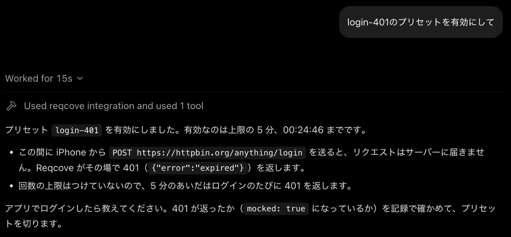
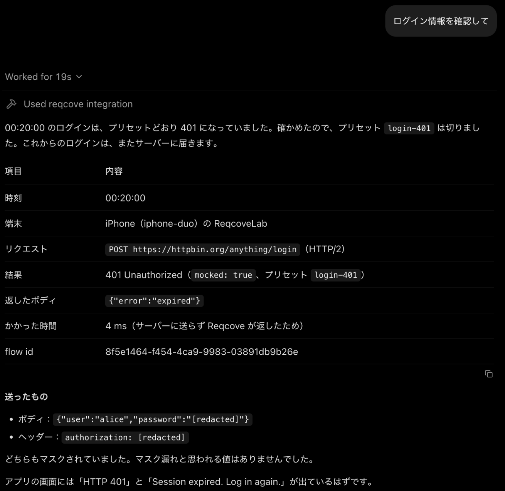
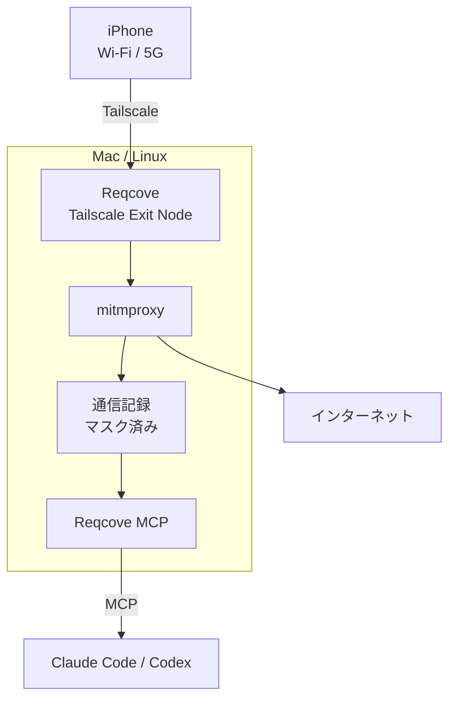
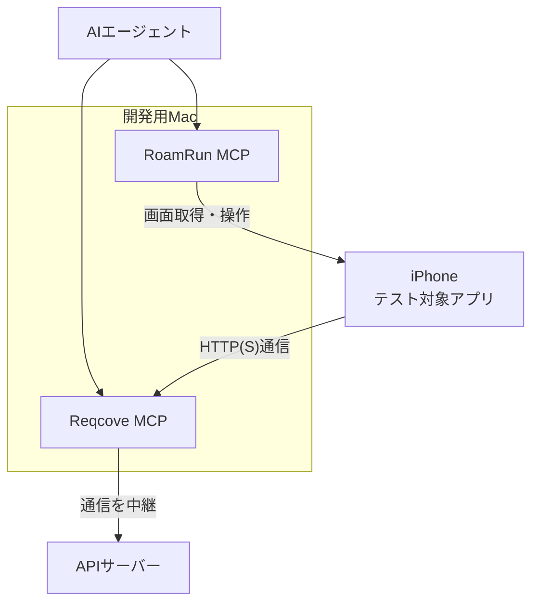

Reqcove（レクコーブ）というOSSを開発しました。iPhoneのHTTP(S)通信を取得し、AIエージェントからMCP経由で調査できるツールです。

https://mh-mobile.github.io/reqcove/

ReqcoveはTailscaleのExit Nodeとmitmproxyを組み合わせた透過型のプロキシです。MacまたはLinux上で動作し、iPhoneから送信されたHTTP(S)通信を記録して、Claude CodeやCodexなどのAIエージェントに渡します。

iPhone側にWi-Fiプロキシを設定する必要はありません。普段使っているTailscaleでExit Nodeを選択し、CA証明書を信頼するだけで利用できます。

さらに、別途開発している[RoamRun](https://github.com/mh-mobile/RoamRun)と組み合わせれば、AIエージェントによるiPhoneの操作から、その操作で発生したAPI通信の調査までをつなげられます。

この記事ではReqcoveを作った背景、仕組み、実際の使い方、そしてRoamRunとの組み合わせについて紹介します。

## なぜReqcoveを作ったのか

最近は、Claude CodeやCodexなどのAIエージェントにiOSアプリの開発を任せる機会が増えました。コードの修正やビルドだけでなく、実機での動作確認やデバッグもできるだけAIエージェントに任せたいと考えています。

そのために必要な情報のひとつが、実機で実際に発生したHTTP通信です。たとえば、アプリのログイン処理に不具合がある場合、ソースコードだけでなく、実際に送信されたリクエストとサーバーから返ってきたレスポンスを確認したくなります。

HTTP通信をAIエージェントに読ませる方法はすでに存在します。Proxymanなど、MCPに対応したプロキシツールもあります。ただ、iPhoneの通信を取得する方法としては、Wi-Fiプロキシの設定や、iPhone上のローカルVPNを利用する構成が一般的です。

自分は普段からTailscaleを利用しており、別途開発しているRoamRunでも、離れたネットワークにあるiPhoneへ接続するためにTailscaleを使っています。そこで、Tailscaleを使っている環境に、HTTP通信の解析機能も組み込めないだろうかと考えました。その結果生まれたのがReqcoveです。

## AIエージェントが実機の通信を調べられる

まず、Reqcove単体で何ができるのかを紹介します。

### 実際に送信されたAPIリクエストを確認する

Reqcoveで通信を記録している状態で、iPhoneからログイン操作を行ったとします。AIエージェントには次のように質問できます。

> 直近10分のhttpbin.orgへのログインの通信を調べて、送ったヘッダーとボディを教えて

エージェントはReqcoveのMCPツールを呼び出し、記録から該当する通信を探します。次の画像はAIエージェントにこの質問をしたときの答えです。

![AIエージェントの答え。ログインの通信のヘッダーとボディを答えている。authorizationとpasswordは[redacted]になっている](/images/reqcove/agent-login.png)

Reqcoveが認識できるパスワードやトークンなどのシークレットは、記録する時点でマスクされます。

エージェントはURL、HTTPメソッド、ステータスコード、ヘッダー、リクエストとレスポンスの内容などをもとに調査できます。たとえば、次のような質問もできます。

- 直近10分間で失敗したAPIリクエストは？
- この画面を開いたとき、どのAPIが呼ばれている？
- ログインに成功したときと失敗したときの通信は何が違う？
- 特定のAPIへのリクエストは何回発生している？

Reqcoveでは`list_flows`、`search_flows`、`get_flow`、`diff_flows`、`summarize`などのMCPツールを提供しています。通信ログをAIに貼り付けるのではなく、エージェントが必要な通信を自分で検索し、詳しく調べられることが特徴です。

### APIのエラーを再現する

Reqcoveは通信を記録するだけでなく、mitmproxyを利用して特定のHTTPリクエストに対してモックレスポンスを返すこともできます。

たとえば、ログインAPIが401エラーを返したときのアプリの挙動を確認したい場合は、次のようなルールを定義します。

```yaml
mock:
  - match:
      method: POST
      url: "https://httpbin.org/anything/login"
    preset: login-401
    status: 401
    body: '{"error":"expired"}'
```

このルールを書いたファイルを`--rules`で読み込ませておくと、AIエージェントがプリセット`login-401`を`activate_preset`で一時的に有効にできます。




この例では、テスト用アプリに「HTTP 401」と「Session expired. Log in again.」が表示されています。モックした通信も記録に残り、Reqcoveはモックによる応答であることを示します。実際のサーバーにはリクエストを送信しません。



ほかにも503エラー、レスポンスの遅延、接続の切断などを再現できます。エージェントが利用できるプリセットは、あらかじめユーザーが用意したものに限定され、1回につき最大5分間有効にできます。この仕組みを使えば、サーバー側の実装を変更せずに、アプリの異常系をテストできます。

## なぜWi-FiプロキシではなくExit Nodeなのか

iPhoneのHTTP通信を取得する方法はいくつかあります。

ひとつは、CharlesやProxymanなどのHTTPプロキシを使用する方法です。一般的には、Macなどでプロキシサーバーを動かし、iPhoneのWi-Fi設定でそのプロキシを指定します。この方法は便利ですが、Wi-Fiごとにプロキシの設定が必要になります。iPhoneが5Gのときの通信を、そのWi-Fiプロキシ設定で取得することもできません。

もうひとつは、ProxymanやCharlesのiOSアプリなどで、iPhone上にローカルVPNを作成して通信を取得する方法です。こちらはiPhone単体で利用でき、5Gでも通信を取得できます。ただし、iOSではTailscaleなどのVPNと、別のローカルVPNを同時に動かすことには制約があります。

Reqcoveではこれらとは異なる構成として、TailscaleのExit Nodeとして動作させる方法を選びました。


TailscaleのExit Nodeは、tailnet内の特定のマシンを経由してインターネットへ通信させる機能です。ReqcoveはこのExit Nodeとして動作します。iPhoneのTailscaleアプリでReqcoveをExit Nodeに選ぶと、通信がReqcoveの動いているコンピュータに中継されます。そのため、次のような使い方ができます。

- iPhoneのWi-Fiプロキシ設定を変更せずに通信を取得する
- iPhoneが5Gでも、別のWi-Fiでも同じ構成で利用する
- 自宅のMacと離れた場所にあるiPhoneの通信を取得する
- Tailscaleを使いながら、別のVPNアプリを起動せずに通信を解析する

5Gでの通信取得自体が新しいわけではありません。既存のTailscale接続を利用して、iPhoneの通信を開発用コンピュータに集められるという構成が、Reqcoveの設計上の特徴です。

## Reqcoveの仕組み

内部の構成は次のようになっています。



ReqcoveはGoで実装した単一のバイナリで、主に次の技術を組み合わせています。

### Tailscale（tsnet）

GoのプログラムからTailscaleのノードを動作させるために使用しています。Reqcove自身がExit Nodeとして動くため、Exit Node専用のマシンを別に用意する必要はありません。

### mitmproxy

HTTPS通信の復号と、HTTPリクエストとレスポンスの処理を担当します。Reqcoveは初回起動時に、uvを使ってPythonとmitmproxyを取得します。

### MCP（Model Context Protocol）

記録した通信をAIエージェントに渡すために利用します。Reqcoveはmitmproxyが解析した通信をメモリ上に保持し、MCPツールから検索、集計、比較できるようにしています。

なお、Reqcoveがmitmproxyに渡すのは、基本的にTCPの80番と443番ポートの通信です。また、記録対象のホストを指定し、それ以外の接続は原則として復号せずに中継します。

## RoamRunと組み合わせると、実機操作から通信解析までつながる

ここからが個人的に特に面白いと考えている使い方です。

自分はReqcoveとは別に、[RoamRun](https://github.com/mh-mobile/RoamRun)というOSSも開発しています。RoamRunはTailscale経由で離れたネットワークのiPhoneをXcodeから利用できるようにするツールで、iOS 27以降ではiPhoneの画面を取得して操作する機能も提供しています。こちらもMCPに対応しています。

:::details RoamRunのMCPツール

| ツール | 役割 |
|---|---|
| `look` | iPhoneの画面を画像として取得 |
| `tap` | 画面をタップ |
| `swipe` | スワイプ |
| `type` / `paste` | テキスト入力 |
| `press` | ボタン操作 |
| `elements` | アクセシビリティ要素を取得 |
| `install` / `launch` | アプリをインストール・起動 |

:::

このRoamRunとReqcoveを、同じAIエージェントから利用できるようにします。



RoamRunが画面操作を担当し、Reqcoveが通信解析を担当します。両者は独立したツールですが、AIエージェントがそれぞれのMCPツールを利用することで、ひとつのデバッグワークフローを構成できます。

### 具体例：ログイン失敗の原因を調べる

たとえば、AIエージェントに次のように指示します。

> RoamRunでiPhoneの開発中のアプリを開いて、ログインを試してください。
>
> ログインに失敗したら、Reqcoveでその操作によって発生したAPI通信を確認し、原因を調べてください。

次の画像はこの指示を出したときの答えです。ログインを失敗させるために、先に`login-401`のプリセットを有効にしています。エージェントはRoamRunで画面を見ながらアプリを開いてログインし、Reqcoveの記録から401がサーバーではなくプリセットのモックから返ったと答えています。


なお、画像の答えには「`{"error":"expired"}`から『Session expired』と表示しました」とありますが、テスト用アプリはステータスコードの401だけで表示を決めていて、ボディは読んでいません。エージェントの説明には、このように確かめていない推測が混ざることがあります。

:::details エージェントの動きを詳しく

RoamRunとReqcoveのMCPツールを組み合わせると、次のような流れになります。

1. AIエージェントが画面を確認します。RoamRunの`look`でiPhoneの画面を取得し、ログイン画面の入力フィールドやボタンを確認します。
2. 通信のチェックポイントを取得します。Reqcoveの`list_flows`や`capture_stats`からチェックポイントを取得しておくと、操作する前とあとの通信を区別できます。
3. ログインを実行します。RoamRunの`tap`や`paste`などで入力と操作を行い、操作後は再び`look`で画面を確認します。
4. 操作後の通信を調べます。Reqcoveの`wait_for_flows`は指定したチェックポイント以降に発生した通信を待って取得します。ログイン操作後に呼び出せば、その操作で発生したAPI通信を調査できます。
5. エラーの原因を分析します。たとえばログインAPIが401を返していた場合、画面にはログインエラーが表示され、通信からは返ってきたレスポンスの内容が確認できます。AIエージェントは両方の情報をもとに、次に何を調査すべきかを判断できます。

:::

さらに、コードの修正やアプリの再ビルドもエージェントに任せれば、修正後の動作確認や通信の比較までつなげられます。

ただし、これらの操作が常に完全自動で成功するわけではありません。画面の状態、ログイン認証、デバイスへの接続状態など、人間による確認が必要な場合もあります。それでも、実機を操作した結果を画面とHTTP通信の両方から調べられるこの使い方には、可能性があると思っています。

## 記録時点でシークレットをマスクする

Reqcoveでは取得した通信のシークレットを、記録する時点でマスクしています。

対象はトークン、APIキー、Cookie、パスワードなど、Reqcoveが識別できるシークレットです。AIエージェントがMCP経由で読む記録も、Reqcoveの`--ui`で表示する記録も、マスク後のデータです。`--ui`は記録した通信をブラウザで見るためのページで、一覧から開いた詳細では、認証情報が`[redacted]`になっています。


![Reqcoveの--uiのページで開いたログインの通信。authorizationとpasswordが[redacted]になっている](/images/reqcove/ui-detail.png =600x)

通信をマスクせずに見たいときは、`reqcove restart --web`で再起動すると、その起動のあいだだけmitmproxyのWeb画面（mitmweb）を使えます。mitmwebの画面はマスクされないため、必要なときだけ使います。


ただし、すべてのシークレットを自動的に検出できるわけではありません。名前からシークレットだと判断できないフィールドや、メールアドレスなどの個人情報はマスクされません。必要に応じて、`--mask-names`や`--mask-values`で追加のマスク対象を指定できます。

また、AIエージェントが読み取った通信の内容は、利用しているモデルの提供元に送信される場合があります。本番のアカウントや個人のデータが送られないよう、開発用のiPhoneと、検証用のサーバーやテスト用のアカウントで使うことをおすすめします。

### エージェントに許可する操作を絞る

ReqcoveではMCPツールから行える変更操作にも制限を設けています。たとえば記録対象のホストを増やす場合、AIエージェントは`request_capture_add`で追加を申請できます。申請しただけでは記録対象は変わらず、ユーザーが承認して初めて追加されます。


`reqcove console`で開く管理画面では、記録対象のホストを変更したり、エージェントからの申請を承認または拒否したりできます。

```sh
reqcove console
```

:::details 変更が反映されるタイミング

管理画面では記録対象のホストの追加や削除、記録の停止と再開を、Reqcoveを止めずに行えます。ホストを追加したときや記録を再開したときは、新しい接続から記録されます。すぐに確かめたいときは、iPhoneのアプリを開き直します。ホストを次の起動にも残すときは、Saveでホストのファイルに書き込みます。デバイスや`--ui`などの設定は設定ファイルに書き込まれ、Reqcoveの次の起動から使われます。Reqcoveの再起動も管理画面から行えます。


:::

自分のtailnetの端末から利用できる管理画面も用意しています。

```sh
reqcove console --tailnet
```

こちらはiPhoneなどから利用でき、記録対象の変更や申請の承認ができます。


ただし、設定の保存やReqcove自体の再起動など、一部の管理操作はReqcoveを動かしているコンピュータの画面（`reqcove console`）に限定しています。

なお、これらの権限の制限はMCPツールだけを持つエージェントに対するものです。同じOSユーザーとしてシェルを実行できるエージェントなら、ReqcoveのCLIを直接呼び出すこともできます。また、HTTPレスポンスなど外部から取得した内容には、プロンプトインジェクションが含まれる可能性があります。エージェントに与える権限そのものを適切に制限する必要があります。

詳しくは[セキュリティドキュメント](https://github.com/mh-mobile/reqcove/blob/main/docs/SECURITY.ja.md)にまとめています。

## 実際に使ってみる

ここではApple SiliconのMacとiPhoneを使い、ReqcoveをClaude Codeから利用するまでの手順を紹介します。必要なものは次のとおりです。

- Apple SiliconのMac（Linuxのamd64とarm64にも対応）
- Tailscaleのtailnet
- TailscaleアプリをインストールしたiPhone
- Claude CodeなどのMCP対応AIエージェント

### 1. Reqcoveをインストール

Homebrewからインストールできます。

```sh
brew trust --formula mh-mobile/tap/reqcove
brew install mh-mobile/tap/reqcove
```

Homebrewを使わない場合は、[GitHub Releases](https://github.com/mh-mobile/reqcove/releases)からバイナリを入手できます。その場合は、uvを自分でインストールしてください。

### 2. 初期設定して起動

```sh
reqcove setup
```

対話形式で、iPhoneのTailscale上のデバイス名と記録対象のホストなどを設定します。設定が完了したら起動します。

```sh
reqcove run
```

初回はTailscaleへのログインや、Tailscaleの管理画面でのExit Nodeの承認が必要になる場合があります。不足している設定は次のコマンドで確認できます。

```sh
reqcove status
```

### 3. iPhoneでExit Nodeを選択

iPhoneのTailscaleアプリを開き、Exit Nodeとして`reqcove`を選択します。続いて、ReqcoveのCA証明書をインストールします。

```sh
reqcove links
```

このコマンドが表示するCAのQRコードをiPhoneで読み取り、構成プロファイルをインストールします。


その後、iPhoneの「設定 › 一般 › 情報 › 証明書信頼設定」でReqcoveのCAを信頼します。


CAを信頼すると、そのCAの秘密鍵を持つコンピュータは、iPhoneのHTTPS通信を復号できるようになります。これは記録対象に指定したホストだけに限定される権限ではありません。自分が管理する検証用端末で利用してください。

### 4. MCPサーバーを登録

Claude Codeの場合は、次のコマンドで登録し、続いてSkillをインストールします。

```sh
claude mcp add reqcove -- reqcove mcp
reqcove init
```

これでClaude CodeからReqcoveのMCPツールを利用できます。iPhoneでアプリを操作したあと、次のように聞いてみてください。

> 直近10分間でapi.example.comへの通信を調べて。エラーがあれば原因を分析して。

### 5. RoamRunも利用する場合

:::details RoamRunのセットアップ

RoamRunは次のコマンドでインストールできます。

```sh
brew install --cask mh-mobile/tap/roamrun
```

iPhoneの画面操作にはiOS 27以降が必要です。RoamRunアプリでデバイスを登録し、「Device control」のセットアップを行います。初回のペアリングには、基本的にMacとiPhoneが同じWi-Fiに接続されている必要があります。その後、MCPサーバーを登録します。

```sh
claude mcp add roamrun -- roamrun mcp
roamrun init
```

これで、Claude CodeからRoamRunとReqcoveの両方のMCPツールを利用できます。RoamRunの画面操作にはRoamRunアプリの起動が、Reqcoveには`reqcove run`の起動が必要です。

なお、RoamRunの画面操作とXcodeのワイヤレスデバッグ接続は別の機能です。画面操作自体にはXcode用のブリッジは必要ありません。

:::

## 制限事項

Reqcoveには、現時点でいくつかの制限があります。

### 証明書ピンニング

証明書ピンニングを行うアプリはReqcoveのCAを受け入れず、HTTPS通信を復号できない場合があります。そのようなホストは`--pass-hosts`で復号せずに中継できます。

### HTTP以外の通信

mitmproxyによる解析対象はTCPの80番と443番ポートです。mitmproxyがHTTPとして解釈できない通信については、接続情報のみ記録される場合があります。

### IPv6とQUIC

ReqcoveはIPv6を拒否し、Apple宛てを除くQUIC通信をドロップします。アプリ側がIPv4やTCPへフォールバックすることを想定しています。

### 記録の保持

通信記録は基本的にメモリ上に保持します。Reqcoveを停止または再起動すると消えるため、必要な記録はHAR形式で保存できます。

### RoamRunの遠隔接続

Reqcoveが5Gで通信を取得できることと、RoamRunが5Gで常に画面操作できることは別です。RoamRunの接続確立にはWi-Fiなどの条件があり、遠隔操作する場合はデバイスの接続状態を確認する必要があります。

## おわりに

ReqcoveはiPhoneのHTTP(S)通信をAIエージェントから利用しやすくするために開発したOSSです。

HTTP通信の解析も、MCPによるAIエージェントとの連携も、既存のツールで実現できる技術です。ReqcoveではそれらをTailscaleのExit Nodeと組み合わせ、iPhone側のWi-Fiプロキシ設定を変更せずに利用できる構成にしました。さらにRoamRunと組み合わせることで、AIエージェントが実機を操作し、その操作で発生したHTTP通信を調べるというワークフローにも応用できます。

今後もiOSアプリ開発で、AIエージェントに任せられる作業を増やしていきたいと考えています。

ReqcoveとRoamRunはどちらもOSSとして公開しています。

https://github.com/mh-mobile/reqcove

https://github.com/mh-mobile/RoamRun

Reqcoveの詳しい使い方は[日本語README](https://github.com/mh-mobile/reqcove/blob/main/README.ja.md)と[ガイド](https://github.com/mh-mobile/reqcove/blob/main/docs/guide.ja.md)に、概要は[公式サイト](https://mh-mobile.github.io/reqcove/)にまとめています。

不具合報告や機能提案、フィードバックも歓迎します。気に入ったらGitHubでスターをもらえると励みになります。

---

### 参考リンク

- [Reqcove 日本語ガイド](https://github.com/mh-mobile/reqcove/blob/main/docs/guide.ja.md)
- [Reqcove セキュリティモデル](https://github.com/mh-mobile/reqcove/blob/main/docs/SECURITY.ja.md)
- [RoamRun 日本語README](https://github.com/mh-mobile/RoamRun/blob/main/README.ja.md)
- [Tailscale：Exit Nodes](https://tailscale.com/kb/1103/exit-nodes)
- [mitmproxy](https://mitmproxy.org/)
- [Model Context Protocol](https://modelcontextprotocol.io/)
